Сегодня появляется третья домашка, и бот снова будет её принимать (вместе с первой). Она целиком про kNN: нужно решить задачу методом ближайших соседей и выбить себе метрики получше. Для мотивации — лидерборд с покемонами.

План лекции: сначала kNN, наш первый алгоритм машинного обучения (подробнее с ним предстоит разобраться в домашке), а потом — как устроен ML-пайплайн, как правильно считать качество и как не прострелить себе ногу, путаясь в собственных данных.

**Главная цель лекции — уйти, понимая разницу между валидацией и тестом.**

## Метод k ближайших соседей

### Идея

kNN — *k nearest neighbours*, метод $k$ ближайших соседей. У нас есть точка в $n$-мерном пространстве, и мы ищем её ближайших «родственников».

Пример — рекомендация музыки. Каждую песню, которую человек уже слушал, размечаем: понравилась — зелёная, не понравилась — красная. Теперь в плейлист заливают новую песню (звёздочка). Показывать её или нет?

Смотрим на точки рядом со звёздочкой. Выбираем число $k$ — сколько ближайших соседей учитываем — и отдаём новой точке самый частый класс среди них.

- Если при $k = 3$ все три ближайших соседа зелёные, то песня, вероятно, понравится.
- Но допустим, среди трёх ближайших два красных и один зелёный. При $k = 3$ ответ — «не понравится». Увеличим $k$ до 5: в окрестность попадают ещё две зелёные точки, становится 3 зелёных против 2 красных, и ответ меняется на «понравится».

В зависимости от того, насколько широкую окрестность мы берём, класс точки может меняться — в этом и вся суть kNN. Если говорить совсем общо, то это всё решение.

Пример со слайда — соседи пронумерованы по возрастанию расстояния:

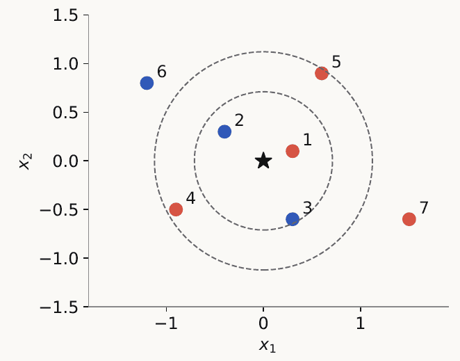

| Сосед | Расстояние | Класс   |
| ----- | ---------- | ------- |
| 1     | 0.316      | красный |
| 2     | 0.500      | синий   |
| 3     | 0.671      | синий   |
| 4     | 1.030      | красный |
| 5     | 1.082      | красный |

- $k = 1$ — красный;
- $k = 3$ — синий;
- $k = 5$ — снова красный.

Алгоритм для каждого нового объекта:

1. Вычислить расстояния до всех объектов из train.
2. Выбрать $k$ ближайших.
3. Вернуть самый частый класс.

Обучение базового kNN — это просто сохранение пар $(x_i, y_i)$. Весь поиск происходит в момент предсказания.

### Откуда у песни координаты

Чтобы искать соседей, точку нужно как-то описать числами. Про песню мы знаем жанр, продолжительность $t$, исполнителя, альбом, лад, количество лайков и так далее. Значит, любую песню можно представить как **вектор признаков (фичей)**.

Если признаков слишком много — например, 250, — можно сделать PCA и ужать их до 50 или 20. Получаем точку в многомерном пространстве, с которой дальше и работаем.

### Сколько это стоит

Самый простой вариант — перебрать все точки и посчитать расстояние до каждой. Это линия на один запрос: $O(n)$ (с учётом размерности — порядка $nd$ операций). Для домашки так уже можно получить баллы, всё будет работать, просто медленно.

А можно ли быстрее? Граф целиком заранее не построить: новая точка появляется только в момент предсказания (как первокурсники 1 сентября, которых нужно внести в уже существующий граф университета). А вот дерево-подобная структура с ответом за логарифм — уже правильная мысль.

### HNSW — иерархический маленький мир

Если гуглить — *Hierarchical Navigable Small World*, HNSW. Идея максимально простая и позволяет ускорять вообще всё на свете.

**Построение.**

- На нижнем, нулевом уровне лежат **все** точки.
- На уровень выше выносим только половину точек, выбранных **случайно**. Ещё выше — половину от них, и так далее, пока не останется совсем мало точек (оставлять одну смысла нет, хватит двух).
- На каждом уровне заранее предподсчитан граф: у каждой точки есть рёбра к её ближайшим соседям на этом уровне. Расстояния здесь считаются только между точками тренировочной выборки — друг между другом.
- Вниз из точки идёт ровно одно ребро — к ней же самой на нижнем уровне. Вбок — несколько, потому что всегда хочется смотреть несколько вариантов, куда пойти.

Случайность выбора важна: если выбирать точки не случайно, сломается эмпирическая история про логарифм.

**Поиск.**

1. Новую точку $x$ «ставим» на самый верхний уровень и считаем расстояния $\rho$ до точек там. Они становятся кандидатами в ближайшие соседи.
2. Спускаемся от кандидатов на уровень ниже. Там уже посчитан граф соседей — смотрим соседей кандидатов и находим новых, более близких.
3. Всё время поддерживаем пул из $k$ лучших кандидатов: всё, что дальше $k$-го, уже неинтересно.
4. Спускаемся до самого низа — именно там лежат все точки, и там можно найти ещё более близкие.

Кандидат найдётся всегда: даже на верхнем уровне у любой точки будут какие-то ближайшие. На каждом уровне делаем мало операций, а уровней при делении пополам — $\log n$. Получается совершенно нормальная асимптотика вместо линии.

Именно этот алгоритм (или ещё один, про который сейчас не рассказываем) живёт внутри продовых векторных баз данных.

### Расстояния

**Евклидово** (оно же $L_2$) — корень из суммы квадратов разностей по всем координатам. Множество точек на расстоянии 1 от центра — кружочек.

$$
d_2(x, u) = \sqrt{\sum_j (x_j - u_j)^2}
$$

**Манхэттенское** ($L_1$) — без квадратов и корня, просто модули разностей. Тоже очень часто используется в ML.

$$
d_1(x, u) = \sum_j |x_j - u_j|
$$

Для $(0, 0)$ и $(3, 4)$: $d_2 = 5$, $d_1 = 7$.

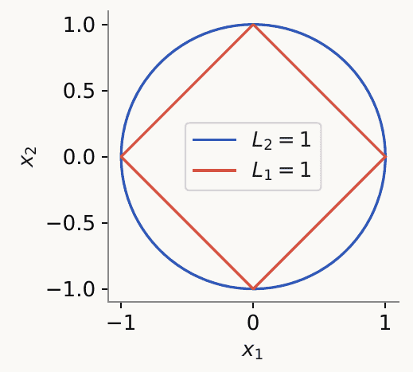

Обобщение: $d_p(x, u) = \left(\sum_j |x_j - u_j|^p\right)^{1/p}$, $p \ge 1$.

Зачем иногда брать квадрат, а иногда модуль? Помним дисперсию: если отклонение большое, то в квадрате оно становится гигантским. А с линейным отклонением разница не такая драматичная. Манхэттенское расстояние позволяет не раздувать огромные отклонения, если они нам не очень интересны.

**Косинусная близость** — сравнивает не значения, а **направления** векторов.

$$
\text{sim}_{\cos}(x, u) = \frac{x^\top u}{\|x\|\,\|u\|}, \qquad d_{\cos} = 1 - \text{sim}_{\cos}
$$

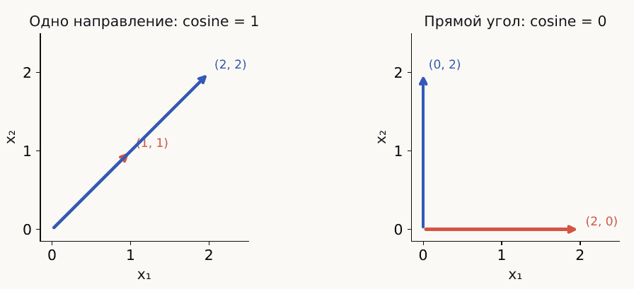

- Векторы сонаправлены — косинусная близость 1, расстояние 0.
- Векторы под прямым углом — близость 0, расстояние большое.

Длина векторов здесь вообще не участвует — важно только направление. Чаще всего косинусное расстояние используется в NLP: слова представляют векторами, и похожие слова оказываются сонаправлены. «Мама» и «мать» — расстояние почти нулевое, «обезьянка» и «граната» — большое. До этого дойдём примерно во второй половине курса, в ноябре.

Иногда делают комбинированный (парный) лосс: учитывают и косинусное расстояние, и обычную метрику вроде евклидовой, каждое со своим весом.

### Веса соседей

Если у каждого соседа одинаковый голос, это может сыграть злую шутку. Пусть новая точка находится далеко от всего остального, но совсем рядом с одной точкой. При $k = 3$ «демократия» отдаст ей класс двух далёких соседей, а не того, к кому она реально близка. Лажа.

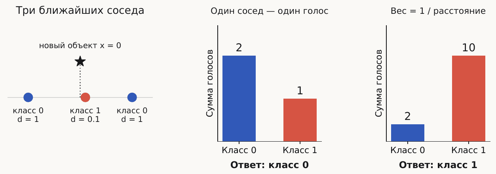

Поэтому соседей начинают **взвешивать**.

**Вес по расстоянию**: $w_i = 1 / d_i$. Точка на расстоянии 0.1 весит в 10 раз больше, чем точка на расстоянии 1 — как будто рядом стоят 10 точек этого класса против одной точки каждого из далёких.

Но и это не всегда хорошо. Пусть ближайшая точка — шумная, а чуть дальше лежит целый кластер другого класса. Если датасет сильно зашумлён, есть выбросы или ему не очень доверяешь, обратная пропорциональность расстоянию даст полную кашу: один шумный сосед перевесит всех.

**Вес по рангу**: соседей упорядочиваем по расстоянию $d_1 \le d_2 \le \dots \le d_k$ и даём

$$
w_i = \frac{k + 1 - i}{k}.
$$

Веса отличаются не сильно: ближайший сосед считается, скажем, за полторы точки, но не за десять.

| Правило       | Формула                   | Что учитываем        |
| ------------- | ------------------------- | -------------------- |
| По рангу      | $w_i = (k + 1 - i)/k$     | Только место в списке |
| По расстоянию | $w_i = 1/d_i$, $d_i > 0$  | Насколько сосед близок |

Для $k = 3$, $d = (0.1, 1, 1)$: по рангу — $(1, \tfrac23, \tfrac13)$, по расстоянию — $(10, 1, 1)$.

Это та же история, что со средним и медианой: параметрические варианты против ранговых. Ранги регулярно возникают во всех алгоритмах ML — **если что-то точное работает фигово, подумайте, можно ли заменить это на ранг.**

### Ядро

**Ядро** — функция, с помощью которой задаётся вес соседа:

$$
w_i = K(r_i), \qquad r_i = \frac{d(x, x_i)}{h}, \quad h > 0.
$$

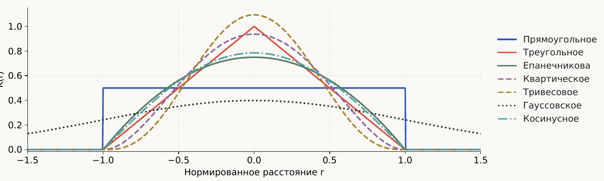

- **Прямоугольное** — то, что было изначально: все соседи равнозначны. Но далёким соседям хочется давать вес поменьше.
- **Треугольное** — линейное убывание. Довольно жёсткое: сильный вес у самых близких и очень маленький у тех, кто в конце топа.
- Можно взять что-то средненькое — подойдёт любая функция, у которой площадь под графиком равна единице. Например, **гауссиана**: тогда учитываются вообще все соседи, просто чем дальше, тем меньше вес. Иногда это очень классное решение, особенно когда точек мало. Или **квадратичная** функция — учитываем близких, но по параболе.

Единичная площадь нужна, чтобы математика красиво сходилась (веса суммировались в единицу). Для ранжирования соседей это не важно.

### Гиперпараметры

Выбор ядра — это **гиперпараметр** алгоритма: то, как мы задаём способ обучения. У kNN их несколько:

- $k$ — число соседей (3, 10, 20…);
- функция расстояния;
- способ взвешивания / ядро;
- ширина окна $h$.

### Ширина окна

Вместо числа соседей можно зафиксировать **радиус**. При прямоугольном ядре каждый объект с $d(x, x_i) \le h$ получает вес 1:

$$
\hat y(x) = \arg\max_c \sum_{i=1}^n K\!\left(\frac{d(x, x_i)}{h}\right) \mathbf{1}[y_i = c].
$$

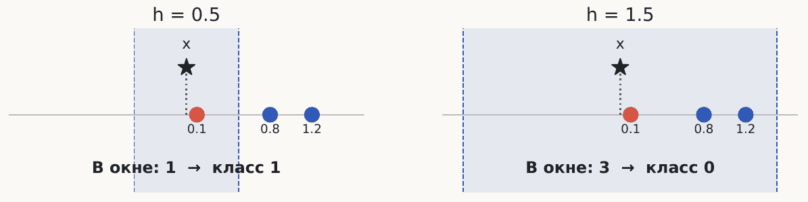

- Фиксируем $h$ — меняется число объектов в окне.
- Фиксируем $k$ — радиус до $k$-го соседа зависит от того, где лежит точка.

С окном радиус один и тот же для любой точки, и он не «прыгает». Ещё это способ находить **выбросы**: если в радиусе вокруг точки вообще ничего нет, класс ей назначить нельзя — она отличается от всего. Через $k$ соседей класс назначился бы всегда.

### Сложность модели

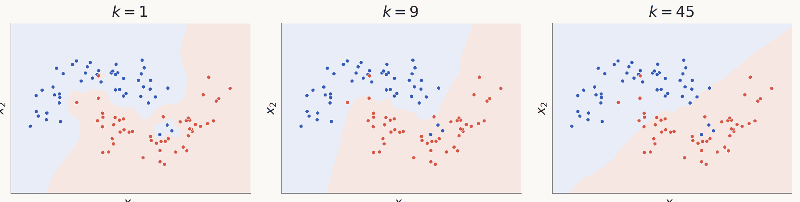

- Маленькое $k$ — модель очень чувствительна к каждому конкретному месту и аккуратно вырезает все границы. Подходит, если действительно нужно найти самого ближайшего соседа и решать по нему.
- Большое $k$ — модель обобщает и хорошо сглаживает.

### Регрессия

Предсказывать можно не только класс. Пусть каждая точка — студент, а значение — его средний балл. Для нового студента хотим предсказать число.

Берём $k$ соседей и **усредняем** их значения с нормированными весами:

$$
\hat y(x) = \frac{\sum_{i \in N(x)} w_i y_i}{\sum_{i \in N(x)} w_i}.
$$

Пример: три соседа набрали за курс 10, 20 и 30 баллов из 100. Тот, у кого 10, совсем рядом, двое других далеко — судя по всему, наш студент не отличник.

| Сосед         | 1   | 2  | 3  |
| ------------- | --- | -- | -- |
| Значение $y_i$ | 10  | 20 | 30 |
| Расстояние $d_i$ | 0.1 | 1  | 1  |

- Равные веса: $\hat y = (10 + 20 + 30)/3 = 20$.
- Веса $1/d_i$: первый сосед в 10 раз ближе, поэтому его вес 10, у остальных по 1 — $\hat y = (10 \cdot 10 + 20 + 30)/12 = 12.5$. Это уже сильно больше похоже на правду.

Регрессия — вторая задача машинного обучения, когда предсказываем число, а не класс. **Это ровно задача из домашки.**

В kNN-регрессии $N(x)$ — это $k$ соседей. В ядерной регрессии берётся весь train с весами $w_i = K(d_i/h)$.

### Ширина окна в регрессии

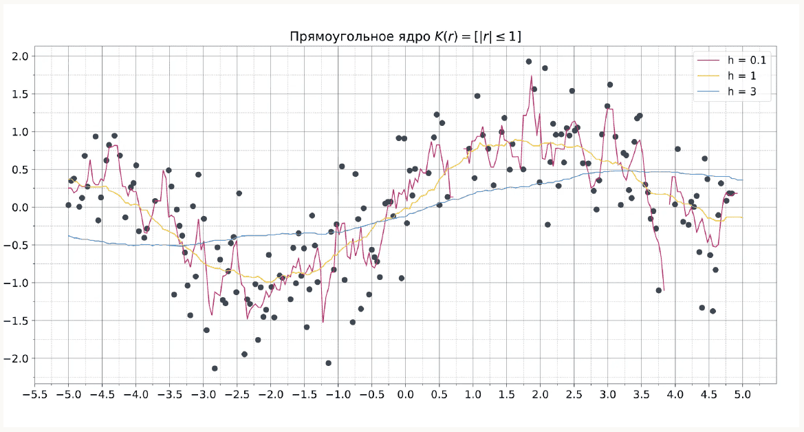

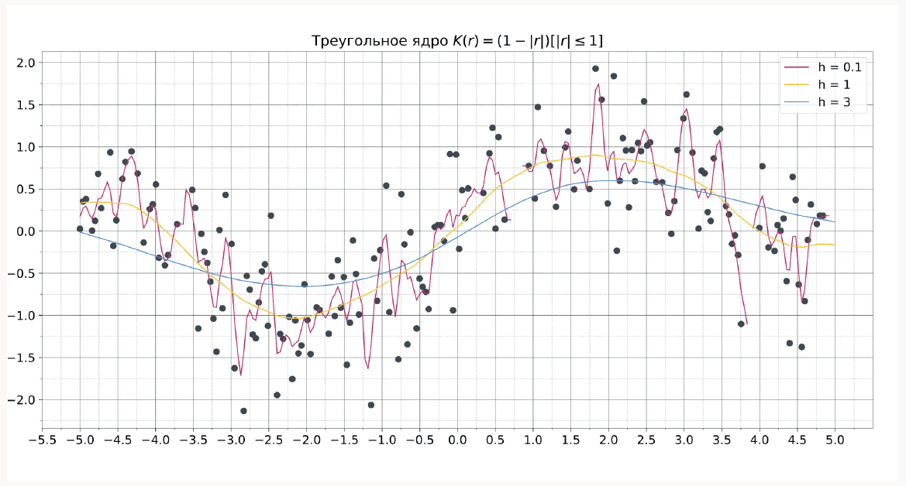

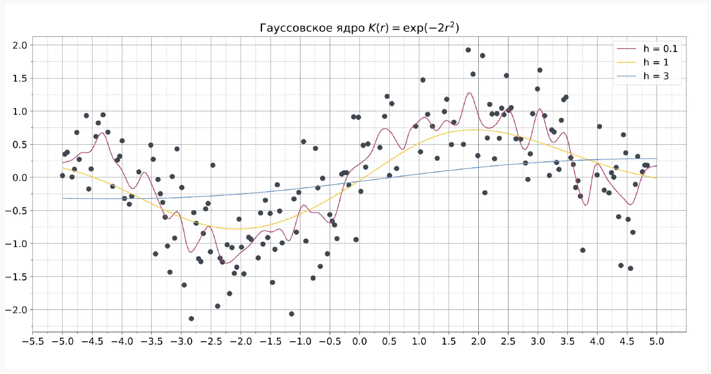

Маленькое окно — функция прерывистая, идёт пиками. Большое — всё очень гладко, разницы будто нет. Здесь лучше всего исходную функцию описывает $h = 1$ (жёлтая кривая).

**Задача машинного обучения — подобрать наиболее простую модель, которая хорошо описывает исходную функцию**, то есть значение параметра, при котором аппроксимация лучшая.

### Плюсы и минусы

**Плюсы:**

- Понятный — реально тривиальная штука, никакой сложности.
- Подходит и для классификации, и для регрессии.
- **Хорошо объясним**: можно показать соседей и сказать, почему принято решение. Раньше в Яндекс.Музыке было «рекомендуем, потому что вам нравился такой-то трек». В ВК постоянно вылезает «ваш друг из такого-то города тоже лайкнул». Маленький лайк друга под постом в Инсте — то же самое.

**Минусы:**

- Нужно хранить всю тренировочную выборку. Представьте масштабы Яндекс.Музыки. С векторной базой данных жить проще, но глобально это сложно.
- Долго работает.
- Часто **переобучается**: хранит много ненужной информации и сильно подгоняется под те данные, которые у него есть.

Поэтому kNN'ом обычно никто не ограничивается и все идут сильно дальше.

Как это выглядит на практике: при $k = 1$ каждый обучающий объект находит сам себя, и на train всё идеально, а на validation качество заметно ниже. Поэтому $k$ выбирают по данным, не использованным для обучения.

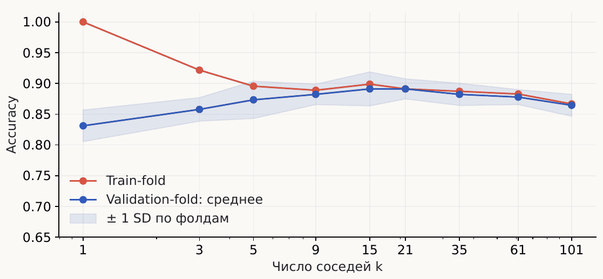

## ML-пайплайн

### Цикл

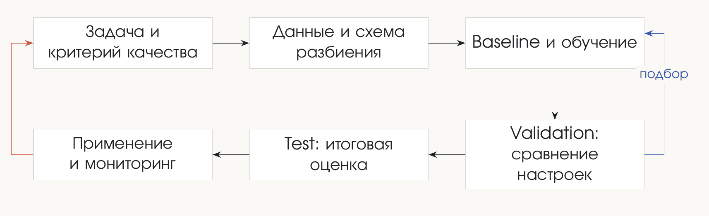

Смотрим на данные, как-то их представляем, обучаем модель, валидируем, тестируем, применяем и мониторим. Мониторинг показывает, что модель работает плохо, и чем дольше работает — тем хуже. В какой-то момент понимаешь, что нужна новая модель: снова собираешь данные, снова смотришь на них, обучаешь, сравниваешь с бейзлайном.

Пайплайн циклический и никогда не заканчивается — разве что модель решит, что всем пора сдохнуть.

### Постановка задачи: фильтр спама

У всех в почте есть папка «Спам». Письма попадают туда через классификатор — это модель машинного обучения, наверное, с 2007 года, с тех пор как появились почты.

| Элемент задачи | Что фиксируем |
| -------------- | ------------- |
| Объект и target | Одно письмо; $y = 1$ — спам, $y = 0$ — обычное письмо |
| Признаки | Текст, отправитель, ссылки — на момент получения |
| Действие | Автоматически отправить письмо в спам |
| Критерий | Ограничить долю обычных писем среди заблокированных, при этом найти как можно больше спама |

Можно ли решать это kNN'ом? Да: собираем выборку писем и для нового письма ищем самые похожие. Здесь как раз возникает косинусное расстояние — но только последние лет 7, с появлением трансформерных моделей, когда слова начали представлять векторами. До этого признаки были проще, например, сколько раз встречается «купить». «Купи», «скидка», «кредит без процентов» — раньше спам отделяли такими стоп-словами: много стоп-слов — в спам.

### Train, validation, test

Допустим, собрали тысячу писем. Их нужно поделить на три части.

Возьмём kNN с $k = 5$ и равномерным ядром (все соседи с одинаковым весом). Обучили, предсказали, получили, скажем, 0.75. А можно лучше? По одной модели этого не понять никогда. Если для $k = 10$ с треугольным ядром получится 0.8, то без перебора мы бы об этом не узнали.

Перебор моделей — это продолжение обучения. **Выбрать модель — значит перебрать гиперпараметры.** Но делать это на тех же данных, на которых модель обучалась, нельзя — нужны новые точки.

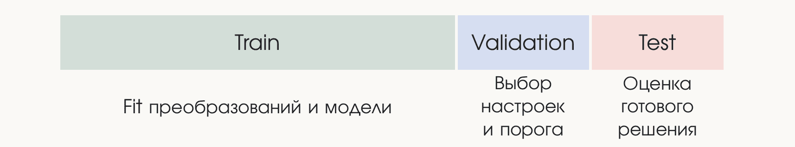

- **Train** — на нём обучаем исходную модель.
- **Validation** — на нём настраиваем модель: выбираем число соседей, ядро, пороги.
- **Test** — данные, которые модель **не видела никогда, ни при каких условиях**. Почему нельзя обойтись validation? В нём могли оказаться выбросы и специфичные значения, и мы подогнали модель так, чтобы она хорошо предсказывала именно эти точки. А нужно понять, работает ли модель на новых данных — как если бы метод обучения машинному обучению проверяли не только на этом потоке, но и на новых студентах.

**Test оценивает уже полностью готовое решение. Финальная цифра, которую вы выдаёте как результат, — это цифра на тесте.**

Про пропорции: на слайде 60/20/20, но это плохое разбиение — выкинуть 40% данных из тренировки слишком дофига. На практике лучше 80/10/10, 70/15/15 или даже 70/20/10. В тест можно оставлять довольно мало данных, но они **должны быть**.

### Как делить: единица разбиения

Есть 100 пользователей, от каждого по 10 записей. После запуска модель будет работать с новыми пользователями (та же Яндекс.Музыка или тот же спам).

| Вариант | Разбиение |
| ------- | --------- |
| A | Случайно распределить 1000 записей между train и test |
| B | Выбрать 80 пользователей для train и 20 других для test |

Правильно **B**. Если раскидать письма случайно, нельзя проверить, что модель адаптируется к новым людям со своими паттернами спама, которых она не видела при обучении. Всегда нужно думать о том, на чём модель будет работать дальше, и делить данные под это.

### Утечки через признаки

Разбиение — не единственный способ устроить утечку. Хотим определить спам **в момент получения письма**:

| Признак | Доступен в этот момент? |
| ------- | ----------------------- |
| Количество ссылок в письме | Да |
| Репутация отправителя по прошлым письмам | Да, если только по прошлому |
| Пожаловался ли адресат на это письмо | Нет: это произойдёт позже |

Будет ли в проде информация о том, что человек пожаловался на письмо? Будет — если вы облажались. Использовать такой признак нельзя: в будущее не заглядываем даже косвенно.

Таких способов случайно засунуть утечку в данные очень много. Всё качество машинного обучения держится на том, насколько хорошо вы подготовили данные и извлекли из них признаки — поэтому вторая домашка была такой адовой и с упором на анализ данных. В 2015 году было классно делать модели, а в 2026 моделями почти никто не занимается — занимаются данными. Данных стало так много и они такие шумные, что потеряться в них и сделать что-то неправильно стало слишком просто.

### Кросс-валидация

**k-fold cross-validation**: вместо отдельной validation-части делим данные на несколько фолдов и каждый раз один из них используем как валидацию.

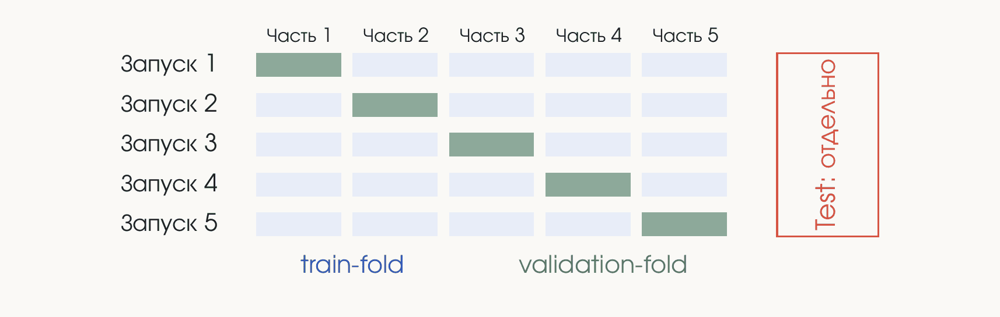

При 5 фолдах модель обучается пять раз на четырёх частях и проверяется на пятой — получается пять результатов. Это даёт не просто пять моделей, а понимание того, **насколько стабильно** модель работает.

- $0.75 \pm 0.02$ — маленький разброс: модель слабо зависит от данных и всегда работает довольно хорошо.
- Разброс $0.32$ — примерно половина скора. Такой модели доверять нельзя: на одних данных она работает отлично, на других — фигово.

В этом главный плюс кросс-валидации: оценивается не только модель, но и её устойчивость.

Плохой результат на одном фолде может означать, что какой-то кусок данных целиком оказался в нём — за распределением фолдов нужно следить. Но чаще всего, если модель плохо работает на новых кластерах, значит, она просто плохо работает и её нужно улучшать.

Test при кросс-валидации по-прежнему откладывается отдельно.
