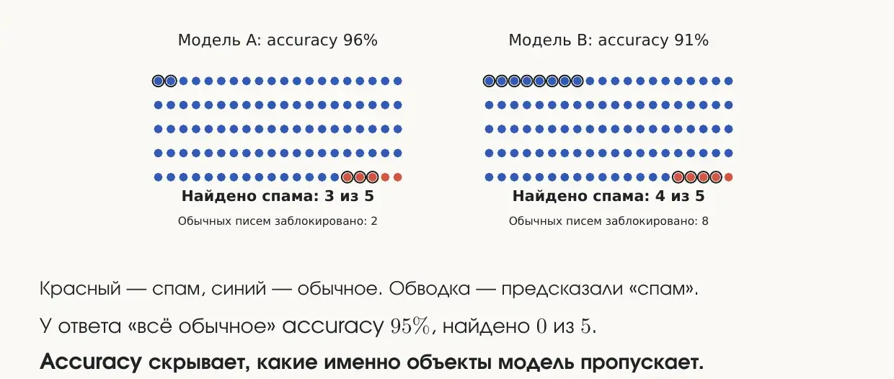
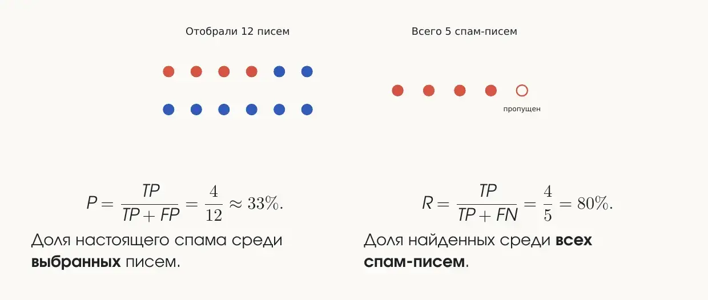
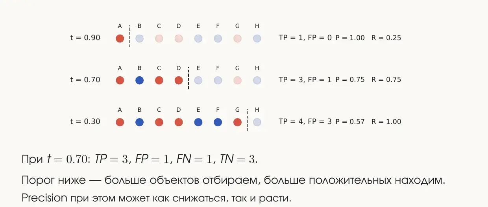
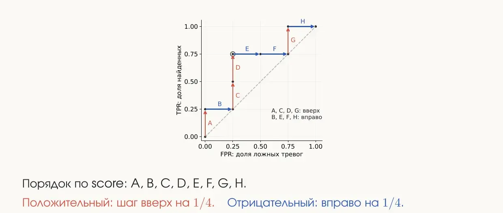
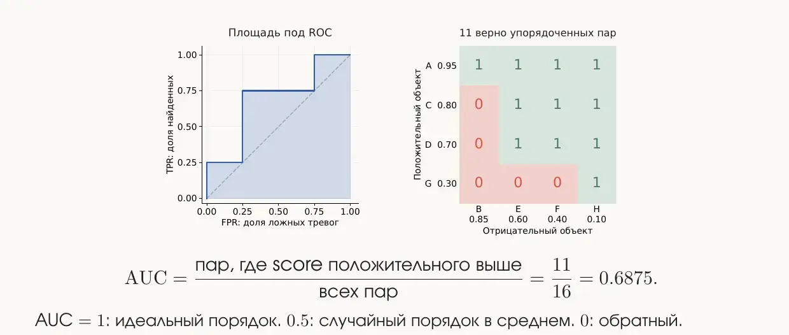
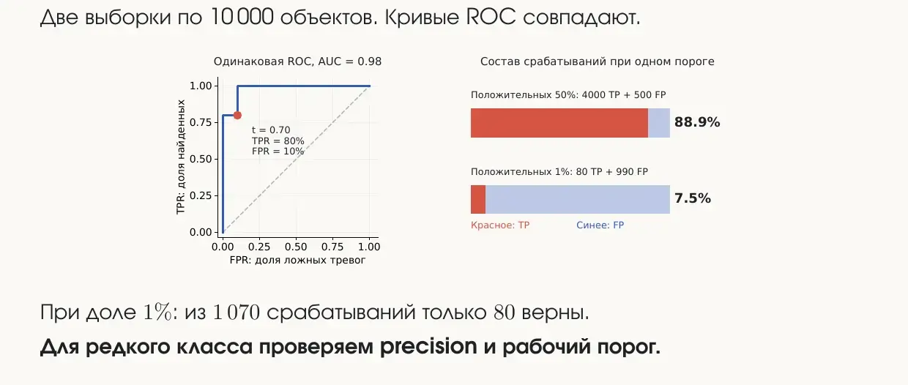
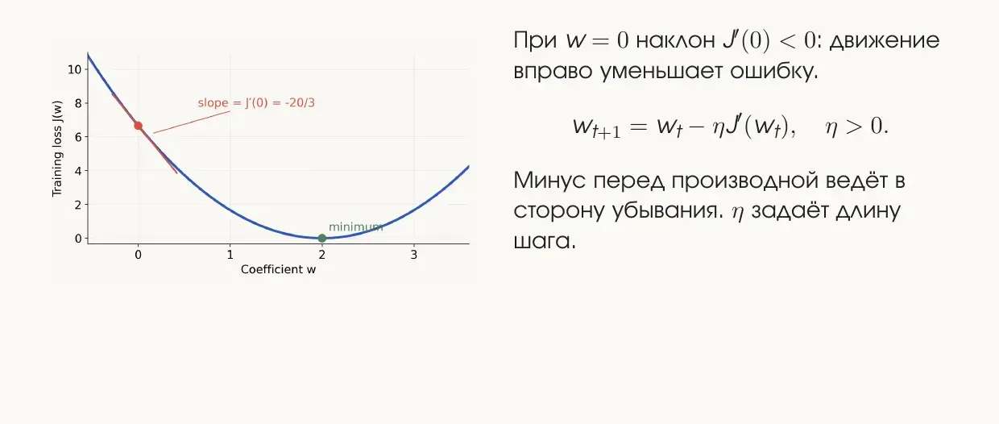
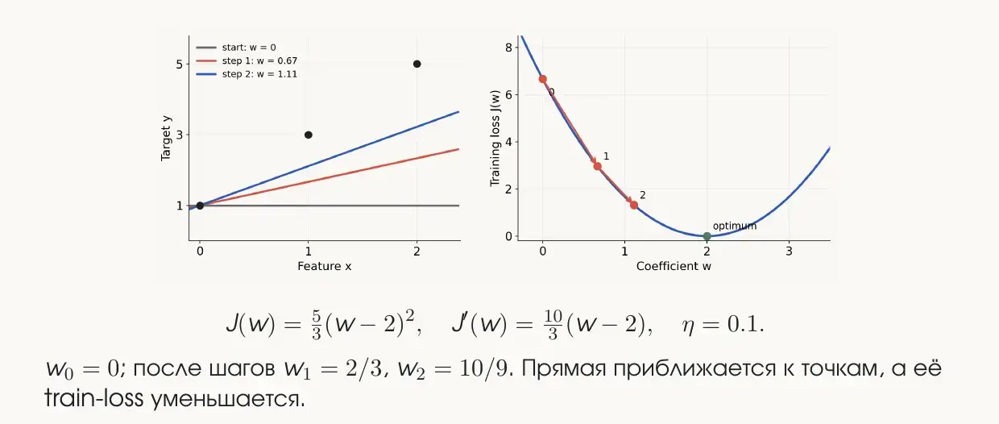
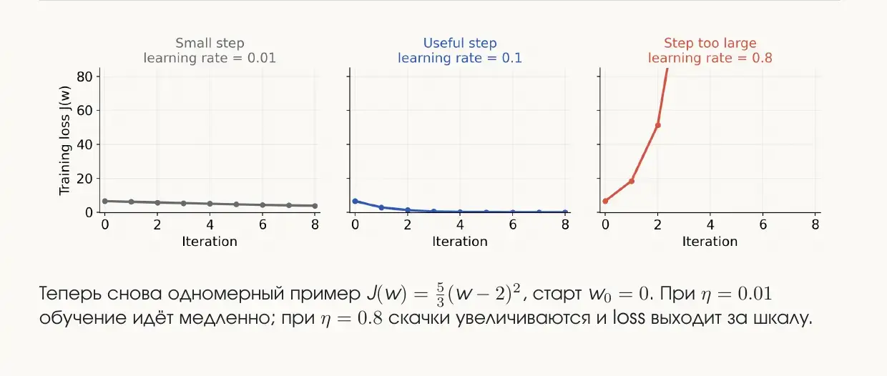
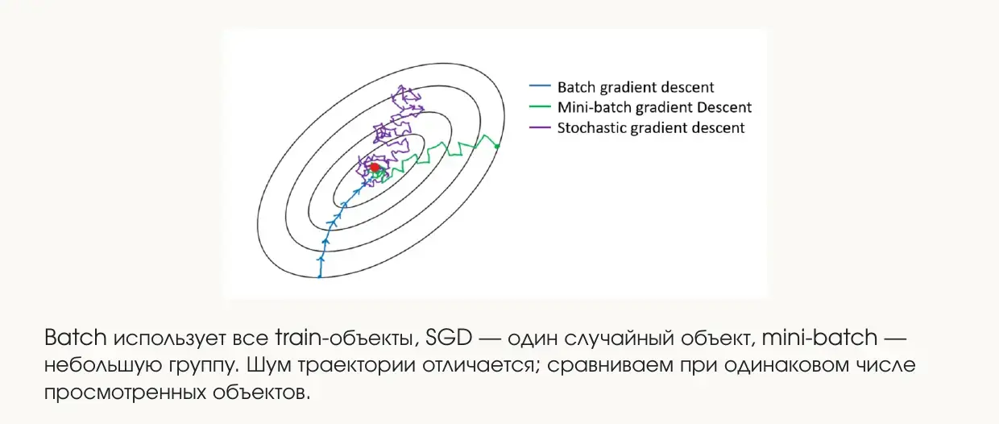

## Организационное

Со следующей домашки появляется лидерборд, причём сразу два: один для решений, сделанных с ИИ, другой для решений, сделанных руками. Лучшие участники каждого из них получат бонус. При заливке коммита нужно будет отметить, сделано решение с ИИ или нет. Если решение действительно сгенерировано, его можно сколько угодно «докручивать», но по возможности стоит делать нормальный коммит со своим решением. Лидерборд с ИИ — для желающих, по сути развлечение.

## Метрики классификации

Классификация — это разделение объектов на классы: у нас есть фиксированное множество классов (кошечки, собачки, программисты, гуманитарии…), и каждый объект нужно отнести к одному из них. Когда появляется классификатор, его качество нужно как-то измерять. Для регрессии мы уже знаем MAE — среднюю абсолютную ошибку. У классификации метрик целая тележка, и почти все они полезны в своих ситуациях.

### Accuracy и дисбаланс классов

Самая простая метрика — **accuracy**, доля верных ответов:

$$
\text{Accuracy} = \frac{\text{число верных ответов}}{\text{число всех объектов}}.
$$

С неё все начинают, потому что она самая простая, — и после этого про неё лучше забыть: на практике её почти не используют.

Пример: 100 писем, из них 95 обычных (синие) и 5 спам-писем (красные). Обводкой отмечены письма, которые модель назвала спамом.

У модели A accuracy 96%, но она нашла только 3 спам-письма из 5. Казалось бы, 96% — это хорошо. Но возьмём модель, которая вообще ничего не делает и всегда отвечает «обычное письмо». Её accuracy — **95%**, при этом она не нашла ни одного спама. Метрика совершенно чётко облажалась: про задачу она не говорит ничего.

Это проблема **дисбаланса классов** — одна из тех, с которыми в машинном обучении очень много мучаются. В идеале классы примерно одинакового размера (50 на 50, 55 на 45). Когда один класс сильно меньше другого, accuracy на это никак не реагирует, а нам как раз важно находить объекты маленького класса — спам, который мы нашли или пропустили.

Одна из идей, как с этим бороться: увеличивать значимость малых классов и уменьшать значимость больших. Так работает **макро-усреднение** метрик (например, macro-F1): оно учитывает маленькие классы в большей степени, а большие — в меньшей.

### Матрица ошибок

Подсказка к тому, что делать дальше: какие вообще есть исходы? У объекта есть истинный класс (0 или 1), и есть предсказанный класс (0 или 1). Итого четыре ситуации:

| Истина \ Предсказание | 1 (спам) | 0 (обычное) |
|---|---|---|
| **1 (спам)** | TP — true positive | FN — false negative |
| **0 (обычное)** | FP — false positive | TN — true negative |

Первая буква говорит, угадали мы или нет (True/False). Вторая — что мы предсказали (Positive — единичку, Negative — нолик). Если был нолик и мы предсказали нолик — угадали, это true negative. Если предсказали единичку, а был нолик — это false positive. Если предсказали нолик, а была единичка — false negative.

Эта табличка называется **матрицей ошибок** (confusion matrix), и все дальнейшие метрики классификации отталкиваются от неё.

Пример для модели B из картинки выше ($N = 100$, положительный класс — спам):

| Истина \ Предсказание | Спам | Обычное |
|---|---|---|
| **Спам** | TP = 4 | FN = 1 |
| **Обычное** | FP = 8 | TN = 87 |

Accuracy через матрицу — это всё, что true, делённое на всё:

$$
\text{Accuracy} = \frac{TP + TN}{N} = \frac{4 + 87}{100} = 91\%.
$$

### Precision и recall

Precision и recall очень легко перепутать — примерно как троллейбус и трамвай, для различения которых нужна целая цепочка ассоциаций. У обеих метрик в числителе стоит $TP$: мы всегда оцениваем, какую часть предсказали корректно. Различаются знаменатели.

**Recall** (полнота) — сколько из всех настоящих единиц мы действительно нашли. Все объекты, которые на самом деле положительные, предсказаны либо как единички (тогда они попали в $TP$), либо как нолики (тогда они попали в $FN$). В сумме это все позитивы:

$$
R = \frac{TP}{TP + FN} = \frac{4}{5} = 80\%.
$$

Recall нужен, когда важно обнаружить как можно больше: можно захватить что-то лишнее, но нельзя пропустить.

- **Мошеннические переводы.** Лучше забанить нормальный перевод — человек через 15 минут сделает его ещё раз, — чем пропустить мошенничество. Банили переводы, кажется, всем.
- **Медицина.** Например, по рентгеновским снимкам предсказывают пневмонию. Лучше записать здорового человека в больные и отправить к врачу на проверку, чем пропустить больного. Особенно это касается онкологии, где болезнь на снимке увидеть действительно сложно.

**Precision** (точность) — посмотрим на всё, что мы предсказали как положительное (там есть и $TP$, и $FP$), и спросим: сколько из этого было правдой?

$$
P = \frac{TP}{TP + FP} = \frac{4}{12} \approx 33\%.
$$

Precision важен, когда нельзя забирать лишнее: например, отправить важное письмо в спам, когда этого делать было не надо.

### F1-score

Оптимизировать одну метрику бесполезно. Recall можно догнать до единицы, просто отправляя всех людей к врачу и баня все транзакции. Precision тоже можно максимизировать, если почти ничего не отправлять в спам. Нужно как-то сбалансировать обе метрики — для этого берут их среднее гармоническое:

$$
F_1 = \frac{2PR}{P + R} = \frac{2TP}{2TP + FP + FN}.
$$

Если $P = R = 1$, сверху получается 2, снизу 2, и $F_1 = 1$. То есть F1 равна единице, когда предсказания идеальны, и цель — её максимизировать. Для модели B: $F_1 = 8/17 \approx 0.47$, для модели A: $F_1 = 0.60$.

Если дают стандартную задачу машинного обучения и нет времени подумать — говорите, что будете оценивать F1. Это лучший вариант по умолчанию: она сбалансированно оценивает и полноту, и точность.

Поверх F1 существуют **micro-, macro- и weighted-F1** — про них стоит почитать в документации scikit-learn или спросить практика. Они очень часто бывают полезны.

### Уверенность модели и порог решения

У любой модели есть некоторая уверенность в своих ответах. Сильнее всего это заметно на нейросетях, но и в kNN модель могла выдавать не просто 0 или 1, а число: мы считали расстояния до соседей, взвешивали их и получали значение. Обычно это число — вероятность того, что объект относится к тому или иному классу. В нейросетях и деревьях такое число есть всегда.

Разные модели работают с уверенностью по-разному: бывают **переуверенные** и **недоуверенные**. Пример из жизни: модель на биологических данных, у которой все нолики получают $0.000001$, все единички — $0.99999$, а между ними пусто. Это плохая ситуация, и дело скорее в хозяине модели, который про неё не подумал.

У нормальной модели можно двигать **порог** $t$, начиная с которого объект относят к единичке:

$$
\hat{y} = \mathbf{1}[s(x) \ge t].
$$

Возьмём 8 объектов: 4 положительных и 4 отрицательных, с порогом $t = 0.7$.

| Объект | A | B | C | D | E | F | G | H |
|---|---|---|---|---|---|---|---|---|
| Класс | 1 | 0 | 1 | 1 | 0 | 0 | 1 | 0 |
| Score | 0.95 | 0.85 | 0.80 | 0.70 | 0.60 | 0.40 | 0.30 | 0.10 |

При $t = 0.7$ единичками считаются A, B, C, D. Получаем $TP = 3$, $FP = 1$, $FN = 1$, $TN = 3$.

Если сдвинуть порог до $0.5$, объект E (0.60) становится единичкой. $TP$ не меняется — единички мы не трогаем. Зато нолик E переходит из $TN$ в $FP$: правильных ноликов становится 2, ложных единичек — тоже 2. Двигая порог, мы всё время меняем метрики.

Чем ниже порог, тем больше объектов отбираем и тем больше положительных находим. Precision при этом может как падать, так и расти.

### ROC-кривая

Будем двигать порог от 0 до 1 очень маленьким шагом — например, $0.01$ — и на каждом шаге считать две величины:

$$
\text{TPR} = \frac{TP}{TP + FN}, \qquad \text{FPR} = \frac{FP}{FP + TN}.
$$

TPR — это тот же recall, доля найденных положительных. FPR — доля ложных тревог среди всех отрицательных.

Крайние случаи:

- порог 0 — всё считаем единичками. Нашли все положительные (TPR = 1), но и все нолики записали в единички (FPR = 1). Точка $(1, 1)$;
- порог выше всех score — ничего не отбираем. Точка $(0, 0)$.

Поэтому кривая всегда начинается в $(0, 0)$ и заканчивается в $(1, 1)$. На нашем примере: идём по объектам в порядке убывания score, положительный объект — шаг вверх на $1/4$, отрицательный — шаг вправо на $1/4$.

На практике точек не 8, а сотни, и получается гладкий график. Это **ROC-кривая** (Receiver Operating Characteristic). На ней можно найти точку-«экстремум» и сказать, что это лучший порог, — так делать можно, но обычно все на это забивают.

ROC-кривые часто строят, чтобы сравнить несколько алгоритмов или несколько наборов гиперпараметров: строим кривые на одном графике, и та, что выше, лучше. Идеальная модель — это «палка»: сразу вверх до TPR = 1, потом вправо.

### ROC-AUC

Удобно считать площадь под ROC-кривой — **ROC-AUC** (Area Under Curve):

- у идеальной модели площадь равна **1**;
- у случайной модели — **0.5**: она как будто кидает монетку, и при пороге $0.3$ записывает в единички 30% и тех, и других объектов — получается диагональ.

Меньше 0.5 получиться вроде бы не может, но иногда получается. Если у вас ROC-AUC = 0.1, не спешите расстраиваться: скорее всего, вы перепутали классы. Переверните их — и получится 0.9.

Площадь руками считать не нужно, для этого есть готовые функции. Полезно знать её смысл: AUC — это доля пар «положительный, отрицательный», в которых score положительного объекта выше.

$$
\text{AUC} = \frac{11}{16} = 0.6875.
$$

### Когда ROC-AUC врёт

Есть ситуации, в которых ROC-AUC показывает лажу.

**Переуверенная модель.** У той самой модели, где всё либо $0.000001$, либо $0.99999$, ROC-кривая выйдет почти идеальной: сначала низко-низко, потом раз — и наверх. А классификатор по факту так себе и требует доработки.

**Дисбаланс классов.** ROC строится на TPR и FPR, и при сильном дисбалансе она не показывает, что происходит с малым классом.

Две выборки по 10 000 объектов с одинаковой ROC-кривой и AUC = 0.98. При доле положительных 50% из срабатываний верны 88.9%. При доле 1% — из 1070 срабатываний верны только 80, то есть 7.5%. Для редкого класса нужно проверять precision и рабочий порог.

### Precision–recall кривая

Вместо TPR и FPR можно построить ту же самую «шляпу» по precision и recall. По горизонтали откладывается recall, который постепенно растёт, по вертикали — precision.

| Выбраны при пороге | TP | Precision | Recall |
|---|---|---|---|
| A | 1 | 1/1 | 1/4 |
| A, B | 1 | 1/2 | 1/4 |
| A, B, C | 2 | 2/3 | 2/4 |
| A, B, C, D | 3 | 3/4 | 3/4 |
| A, …, G | 4 | 4/7 | 4/4 |

Уровень случайной модели на PR-кривой — это доля положительных объектов (в примере $4/8 = 0.5$). Интересно, насколько выше этого уровня находится кривая.

В пару к PR-кривой идёт **Average Precision** — среднее значение precision по всем порогам:

$$
\text{AP} = \sum_k (R_k - R_{k-1}) P_k = \frac{1}{4}\left(1 + \frac{2}{3} + \frac{3}{4} + \frac{4}{7}\right) \approx 0.747.
$$

AP понадобится в следующей домашке.

## Метрики регрессии

В регрессии мы предсказываем число. Есть точки, есть прямая, которой мы их приближаем.

**MAE** (Mean Absolute Error) — берём расстояние от прогноза до каждой точки, складываем и усредняем:

$$
\text{MAE} = \frac{1}{n}\sum_{i=1}^{n} |y_i - \hat{y}_i|.
$$

**MSE** (Mean Squared Error) — то же самое, но каждую ошибку возводим в квадрат:

$$
\text{MSE} = \frac{1}{n}\sum_{i=1}^{n} (y_i - \hat{y}_i)^2.
$$

**RMSE** — корень из MSE:

$$
\text{RMSE} = \sqrt{\text{MSE}}.
$$

Пример со слайдов: концентрация вещества в мг/л.

| Образец | A | B | C |
|---|---|---|---|
| $y$ | 2 | 4 | 6 |
| $\hat{y}$ | 3 | 4 | 5 |
| Ошибка | +1 | 0 | −1 |

$\text{MAE} = 2/3$ мг/л, $\text{MSE} = 2/3$ (мг/л)², $\text{RMSE} \approx 0.82$ мг/л.

Чем они отличаются? Нарисуем одну точку-выброс. **MSE** будет учитывать её сильнее: ошибка возводится в квадрат, и большой кусок становится ещё больше. **MAE** выбросы в большей степени игнорирует.

| Модуль ошибки | Вклад в MAE | Вклад в MSE |
|---|---|---|
| 1 | 1 | 1 |
| 4 | 4 | 16 |

Зачем нужен RMSE? Из-за размерности. Если мы предсказываем рост в метрах, то MSE измеряется в квадратных метрах, а так делать не хочется. Корень возвращает нас обратно к метрам.

### R²

Метрика $R^2$ используется не так уж часто, но полезна для понимания.

Пусть у нас есть точки, и мы хотим провести через них прямую. Какую самую тривиальную прямую можно построить, не зная никакого алгоритма? Константную: горизонтальную прямую на уровне среднего значения $y$. Для неё не нужно никакого ML, это наш **бейзлайн**.

В классификации понятно, что такое случайный классификатор — он кидает нолики и единички наугад. В регрессии такого понятия нет, поэтому случайным классификатором договорились считать горизонтальную прямую на уровне среднего. $R^2$ показывает, насколько модель лучше этого бейзлайна:

$$
R^2 = 1 - \frac{\sum_i (y_i - \hat{y}_i)^2}{\sum_i (y_i - \bar{y})^2} = 1 - \frac{\text{SSE}}{\text{SST}}.
$$

- **Знаменатель** — ошибки бейзлайна: для каждой точки разница между реальным $y_i$ и средним $\bar{y}$, в квадрате.
- **Числитель** — ошибки нашей модели: разница между $y_i$ и предсказанием $\hat{y}_i$, в квадрате. Это почти MSE, только без деления на $n$.

Ошибки считаются **по вертикали**, а не перпендикуляром к прямой: для каждого $x$ мы сравниваем, какой $y$ предсказали и какой был на самом деле.

Смысл формулы — насколько меньше ошибок мы совершаем по сравнению с бейзлайном. Если ошибок почти нет, получаем $1 - 0 = 1$. Если модель не лучше бейзлайна — 0. А ещё $R^2$ **умеет быть отрицательным**: если модель ошибается сильнее, чем горизонтальная прямая на уровне среднего. Пример: на $y = (2, 4, 6)$ модель предсказала $(5, 5, 5)$:

$$
\text{SSE} = 9 + 1 + 1 = 11, \quad \text{SST} = 8, \quad R^2 = 1 - \frac{11}{8} = -0.375.
$$

Для модели $(3, 4, 5)$ из прошлого примера $R^2 = 1 - 2/8 = 0.75$.

В машинном обучении обычный $R^2$ практически не встречается. В статистике у него есть много модификаций, и там используют **Adjusted $R^2$**. Если полезете в анализ данных и статистику, он понадобится; про случаи, когда обычный $R^2$ работает плохо, много хороших примеров на StatQuest.

## Линейная регрессия

Вторая модель машинного обучения после kNN. Линейная регрессия — первый шаг к нейросетям: дальше в неё можно добавить ядра и строить на них много таких регрессий.

Метод наименьших квадратов мы сейчас выводить не будем: интереснее разобрать концепции, которые дальше понадобятся в ML.

### Модель

Есть значение $y$, которое мы хотим получить, и функция с параметрами. Для одного признака:

$$
\hat{y} = b + wx.
$$

Привыкайте, что коэффициент наклона обозначается не $k$, а $w$ — от *weight*. В машинном обучении никаких $k$ не будет.

Обычно $x$ — это вектор признаков. Например, предсказываем рост человека: в признаки можно записать возраст, образование, количество часов за телефоном, количество сыгранных игр и так далее. Тогда и веса — вектор $w$, а модель выглядит так:

$$
\hat{y} = b + \sum_{j=1}^{p} w_j x_j.
$$

Эта запись понадобится, чтобы брать градиент.

### Функция потерь

Из всего вагона возможных прямых нужно выбрать оптимальную. Для этого нужно измерить ошибку — отклонение от того, что мы ожидаем. В контексте обучения её называют **loss** или **функцией потерь**. Чаще всего в качестве loss берут MSE:

$$
J(b, w) = \frac{1}{n}\sum_{i=1}^{n} (y_i - b - w x_i)^2.
$$

Задача — найти такие $b$ и $w$, при которых $J$ минимальна. Математики и статистики, которые это выводили, не пользовались словом MSE и записывали всё через матрицы: если добавить в $X$ столбец единиц для $b$ и собрать параметры в вектор $\beta$, получится

$$
J(\beta) = \frac{1}{n}\|X\beta - y\|_2^2.
$$

Пример: точки $(0, 1), (1, 3), (2, 5)$.

| Модель | Прогнозы | SSE | MSE |
|---|---|---|---|
| $\hat{y} = 1 + x$ | (1, 2, 3) | 0 + 1 + 4 = 5 | 5/3 |
| $\hat{y} = 1 + 2x$ | (1, 3, 5) | 0 | 0 |

С матрицами всё просто, решение всегда можно выписать. Но есть ситуации, когда его нельзя вычислить, и оно не всегда даёт лучший результат: идеально метод наименьших квадратов работает для «чистых» функций, а мы живём в мире данных, где всё с погрешностями. Поэтому появились методы оптимизации — про них стоит посмотреть что-нибудь на YouTube, это реально полезно.

## Градиентный спуск

### Интуиция: шарик в яме

Производная — это скорость, с которой меняется функция. Как найти минимум функции? Возьмём шарик (или маркер, или козырёк кепки) и покатим его по поверхности. Он катится, катится и остаётся в самом низу. Сколько лет прошло, сколько всего придумали в ML, а всё равно катаем шарик.

Пусть мы стартовали в какой-то точке. Производная — это наклон касательной. В многомерном случае (как на кепке) касательная — уже не прямая, а целая плоскость. Градиент направлен в сторону возрастания функции, то есть наверх. А нам нужно к минимуму, поэтому идём в противоположную сторону — по **антиградиенту**:

$$
w_{t+1} = w_t - \eta J'(w_t), \quad \eta > 0.
$$

### Размер шага и learning rate

Насколько далеко идти? У градиента есть **модуль** — длина вектора. Чем круче функция, тем больше модуль градиента. Если идти на целое значение градиента, можно слишком сильно убежать и начать дёргаться из стороны в сторону вокруг минимума.

Поэтому вводят **learning rate** $\eta$: умножаем градиент на маленькое число, например $0.01$, и делаем шажок поменьше. Первый шажок — сюда, второй — чуть дальше, и постепенно приходим близко к минимуму.

Пример со слайдов: $J(w) = \frac{5}{3}(w - 2)^2$, $J'(w) = \frac{10}{3}(w - 2)$, $\eta = 0.1$, $w_0 = 0$. После двух шагов $w_1 = 2/3$, $w_2 = 10/9$ — прямая приближается к точкам, loss уменьшается.

Learning rate может быть:

- **слишком маленьким** — много итераций, которые почти бесполезны: 200 итераций, и мы едва сдвинулись;
- **слишком большим** — начинаем перепрыгивать через минимум и колебаться;
- **оптимальным** — к нему и стремимся.

### Локальные минимумы

Если стартовая точка неудачная, шарик может скатиться в **локальный** минимум, а не в **глобальный**. Градиентный спуск — метод поиска локальных минимумов: никогда нельзя гарантировать, что найден самый минимальный минимум функции.

Иногда перепрыгивание даже полезно. Если шаг большой, можно перескочить пик и укатиться в соседнюю яму, а при удачно подобранных шагах — оказаться в глобальном минимуме.

Это интересное направление в современном ML. Раньше считалось, что модель при обучении выходит на плато, и дальше сколько ни учи — качество одинаковое. Сейчас, когда вычислительные мощности позволяют учить очень долго, оказалось, что для некоторых задач модель может выйти на новое плато и найти новые минимумы, о которых раньше никто не догадывался.

### Batch, mini-batch и стохастический градиентный спуск

Обычный градиентный спуск считает градиент по всем объектам. А если объектов 100 000? Посчитать по всем — долго, хочется быстрее.

**Batch gradient descent** (синий) идёт по всем точкам. Он целенаправленно и аккуратно движется в минимум, но одна итерация стоит очень много времени. Его можно будет реализовать, возможно, уже в этой домашке — это не обязательная часть.

**Mini-batch** (зелёный) немного читерит. Оказывается, если считать градиент не по всем объектам, а по их части, мы всё равно движемся примерно в сторону минимума. Каждый раз вытаскиваем из выборки подвыборку на 100, 10 или 5 элементов и по ней считаем градиент. Это быстро, но результаты не всегда лучшие: подвыборка иногда репрезентативная, а иногда нет. Траекторию немного косит, но некритично.

**Стохастический градиентный спуск, SGD** (фиолетовый) — весельчак. Каждый раз из выборки в 100 000 элементов берём **один случайный** объект (равномерно, без всякого отбора) и делаем шаг по нему. Одна итерация стоит одного объекта. С одной стороны, это быстро, с другой — нас таскает в разные стороны. Но если запустить очень много итераций, мы всё равно придём к минимуму.

Градиент MSE складывается из вкладов отдельных объектов: вклад объекта равен $(2e_i,\ 2e_i x_i)$, где $e_i = \hat{y}_i - y_i$. Пример на точках $(0,1), (1,3), (2,5)$ при старте $b = 1$, $w = 0$:

| Объект | $x_i$ | $y_i$ | $e_i$ | вклад в $\partial J / \partial b$ | вклад в $\partial J / \partial w$ |
|---|---|---|---|---|---|
| 1 | 0 | 1 | 0 | 0 | 0 |
| 2 | 1 | 3 | −2 | −4 | −4 |
| 3 | 2 | 5 | −4 | −8 | −16 |
| **Среднее** | | | | **−4** | **−20/3** |

Batch усредняет все три вклада, SGD берёт один случайный, mini-batch усредняет несколько. Оба градиента отрицательные, поэтому при положительном $\eta$ и $b$, и $w$ увеличатся: при $\eta = 0.1$ получаем $b = 1.4$, $w = 2/3$.
