## Организационное

**Проект на пятёрку.** Это должно быть что-то осязаемое, и данные для него нужно продумать и собрать самостоятельно. Взять готовый датасет с Kaggle и что-то на нём сделать не подойдёт. Нужно выдвинуть гипотезу (утрированный пример: «птички чаще летают в солнечный день», но хочется чего-то поинтереснее), а дальше на её основе строить модели и делать выводы. Тему согласовываем либо с лектором, либо с практиком: если практик одобрил, можно начинать. Список критериев с ожидаемым объёмом появится до начала ноября. Официально проект сдаётся на экзамене, но если готово раньше, можно приносить раньше. Сделать всё к декабрю — хороший вариант.

**Рубежка.** Списка вопросов не будет: на рубежке всё, что было на лекциях. Берём презентации и учим. Термины в конце каждой презентации — точка старта для подготовки. Рубежка проходит на практике, на целую пару. Из-за того, что всё съехало на неделю (была дополнительная пара по анализу данных), план такой: 6 октября — деревья, 13-го — леса, 20-го — кластеризация, затем рубежка, скорее всего 27-го.

**Экзамен.** Список вопросов будет, вопросов не больше 10. Скорее всего это будут задания по полтора-два балла.

**Домашки.** Домашка по деревьям выйдет сегодня-завтра и будет довольно маленькой. Следующая, шестая, — по бустингам: нужно будет спроектировать своё решение. Она **очная**, большая и страшная (не настолько, как в анализе данных, но всё равно), со сдачей через неделю. Её постараются выложить заранее, так что планируйте время.

## Зачем вообще деревья

Всё гениальное просто, и деревья решений — ровно про это: можно сделать совершенно тупую штуку, и она будет работать. Алгоритму лет 50–60 (подходы появились примерно в 70-е), вокруг давно есть нейронки, но деревья продолжают использоваться повсюду. Например, CatBoost, разработанный в Яндексе, очень долгое время помогает решать задачу поиска. Random forest и бустинг, о которых вы наверняка слышали, строятся на деревьях решений. Из классического ML это, пожалуй, самое полезное, что бывает.

Из курса в этом году выкинут **SVM** (Support Vector Machine, метод опорных векторов). Работает он иногда не хуже random forest, но звучит и понимается очень страшно, а интерпретируется заметно хуже деревьев. Математика там очень прикольная, но сложная — почитайте сами, если интересно.

Интуитивно дерево решений похоже на то, как мы сами принимаем решения. Представим, что передо мной случайный студент и я решаю, отчислять его или нет. Домашки сдавал? Нет — это в сторону отчисления, большинство тех, кто не делает домашки, должны быть отчислены. Может, он болел? Да, долго болел — тогда, может, не отчислять. А за лето всё выучил? Нет — тогда всё-таки отчислить. Дерево делает ровно это: берёт объект и классифицирует его набором правил.

## Правила и закономерности

### Интерпретируемые закономерности

Закономерность $\varphi$ называют **интерпретируемой**, если она:

- сформулирована естественным языком;
- зависит от небольшого числа признаков или условий.

Пример из русского языка: если наречие оканчивается на шипящую, в конце пишется «ь» (настежь, сплошь). У правила есть исключения: уж, замуж, невтерпёж. Пожалуй, только у «жи-ши пиши с буквой и» исключений нет, а у остальных правил они почти всегда есть.

### Информативность

У каждого правила есть **информативность**, и не все правила одинаково полезны. Если «жи-ши» — то всегда «и», это правило работает на 100%. А правило про шипящие на конце наречий имеет исключения, и информативность у него уже другая.

Ещё пример: правило «отчисляю всех студентов, у которых 59 баллов». Во-первых, это правило должно быть неравенством: отчисляем при $59$ баллах **и меньше**. Во-вторых, есть исключения: человек мог облажаться на рубежке, но весь год стараться и участвовать на парах — тогда, возможно, ему стоит дать доп. задание. В каких-то ситуациях исключений больше, в каких-то меньше.

Формально: пусть $\varphi(x) = 1$ означает, что правило выполнено, а $c$ — интересующий нас класс.

$$
p_c(\varphi) = \left|\{x_i : \varphi(x_i) = 1,\ y_i = c\}\right| \to \max
$$

$$
n_c(\varphi) = \left|\{x_i : \varphi(x_i) = 1,\ y_i \ne c\}\right| \to \min
$$

- $p_c$ — истинно положительные срабатывания;
- $n_c$ — ложно положительные срабатывания.

Хочется охватить побольше объектов класса $c$ и поменьше объектов других классов.

Полезность правила оцениваем **по данным**. На словарь полагаться нельзя: он обновляется медленно (например, «кофе» в среднем роде появился в словаре совсем недавно).

### Пример с погодой

| День | Погода | Температура | Влажность | Ветер  | Играем? |
|------|--------|-------------|-----------|--------|---------|
| 1    | Sunny  | Hot         | High      | Weak   | No      |
| 2    | Cloudy | Hot         | High      | Weak   | Yes     |
| 3    | Sunny  | Mild        | Normal    | Strong | Yes     |
| 4    | Cloudy | Mild        | High      | Strong | Yes     |
| 5    | Rainy  | Mild        | High      | Strong | No      |
| 6    | Rainy  | Cool        | Normal    | Strong | No      |
| 7    | Rainy  | Mild        | High      | Weak   | Yes     |
| 8    | Sunny  | Hot         | High      | Strong | No      |
| 9    | Cloudy | Hot         | Normal    | Weak   | Yes     |
| 10   | Rainy  | Mild        | High      | Strong | No      |

В зависимости от погоды, температуры, влажности и ветра решаем, идём ли играть в футбол. Какие правила видно? Например, «если Rainy — не играем» (с исключением в день 7). А ещё: **если Cloudy — всегда играем**. С первого взгляда в такой таблице это заметить сложно, колонок довольно много.

Возникает вопрос: что важнее — правило, которое однозначно определяет ответ, но работает на маленьком числе строк, или правило с исключениями, но для большого числа строк? Зависит от ситуации. Иногда классно выделить пару объектов, сразу всё про них узнать и просто про них забыть. А иногда классно из 200 строк выделить 100, среди которых всего 5 исключений: исключения потом можно обработать отдельно следующим разделением.

Если сначала отделить Cloudy, а затем отдельно поделить Sunny и Rainy, получится дерево:

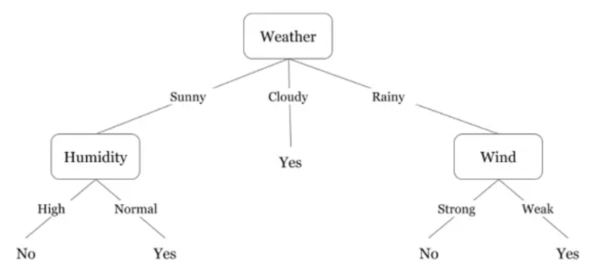

Путь от корня до листа объединяет несколько условий, например: **Rainy** и **Strong wind** ⇒ **No**.

Дерево симметричное, но **не бинарное**. Странно, конечно: на третьем курсе все всегда твердят, что делать надо бинарно. К этому вопросу ещё вернёмся.

### Откуда берутся правила

1. **Создать руками** — посмотреть методом пристального взгляда на табличку и повыделять правила.
2. **Позвать экспертов.** В нашем случае эксперт — семилетний мальчик: «Сегодня 20 градусов и очень душно, пойдёшь играть?» — «Да». — «А ещё и дождь идёт?» — «Не, я в игры поиграю». Настоящий эксперт в своём деле. Проблема в том, что эксперт нужен, а его может не быть: среди сотни человек в аудитории нет ни одного семилетнего мальчика, а в задаче посложнее понадобился бы, например, химик-органик (из зала: «есть Claude Code» — мир действительно развивается, но в базовой ситуации химиков-органиков у нас не водится).
3. **Обучить по данным** — с помощью алгоритмов оптимизации, эвристик или алгоритмов машинного обучения. Именно этим и занимается дерево решений.

## Устройство дерева решений

Дерево решений — алгоритм классификации и регрессии.

| Элемент | Что содержит |
|---|---|
| Внутренний узел | Разделяющее правило, вопрос об объекте (например, $x \le 59$) |
| Ребро | Один из ответов на вопрос в родительском узле — переход от одного правила к другому |
| Лист | Прогноз: класс для классификации или число для регрессии |

В листе классификации обычно выбираем наиболее частый класс, а доли классов дают оценку вероятностей.

### Почему нельзя просто всё «заифать»

Если захардкодить все случаи ифами, то при новом варианте придётся молиться или добавлять новый `if` — больно. Но с точки зрения ML главная проблема другая: случится **переобучение**. Модель просто подстроится под тренировочный датасет и на новых данных будет предсказывать то, что тупо выучила. У модели должна быть **обобщающая способность**, а это значит, что на тренировке обязательно будет какой-то шум. Если тренировочные данные размечены моделью идеально и, скажем, F1-score равен единице, скорее всего на новых данных всё будет очень плохо. В домашке по деревьям это можно будет внимательно поглядеть.

### Про бинарность

Бинарность нужна только для простоты оптимизации. Если научиться оптимизировать небинарные деревья, их можно спокойно использовать. Это удобно для категориальных переменных: не хочется раскладывать категорию на десяток правил. Хотя, по секрету, встроенное дерево решений в scikit-learn делает именно это — раскладывает. Но никто не мешает сделать иначе.

### Пример: учебный кредит

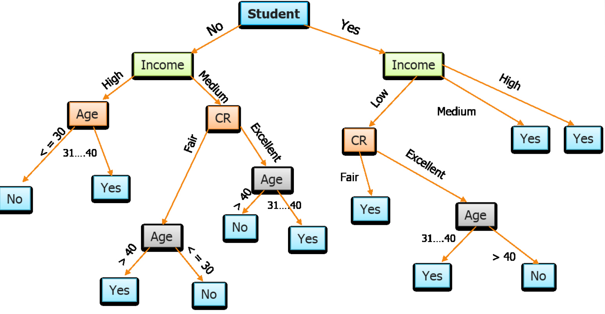

Что пытается определить это дерево? Изначально оно сделано, чтобы понять, давать ли человеку **кредит на учебу** (в Штатах это очень модная вещь). Дерево бинарное там, где надо, в конце есть терминальные вершины с yes/no, и в целом это валидное дерево. Но глядя на него, совершенно непонятно, какой у банка план. Например, человеку старше 40 с хорошим кредитным рейтингом, но почти без денег, кредит не дают — странно.

То же самое решение можно описать другим деревом:

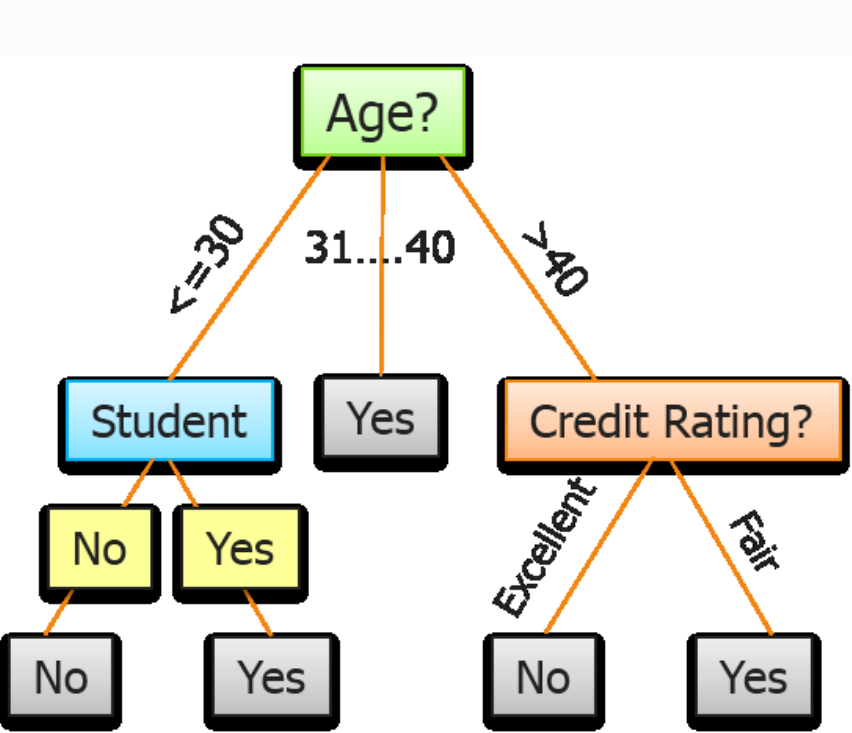

Сначала делим по возрасту на группы до 30, 31–40 и старше 40, затем смотрим на кредитный рейтинг или на то, студент ли человек. По какому принципу думают банки — отдельный вопрос, но это дерево дублирует предыдущее, и по нему сразу понятно, по какому принципу кредит дают или не дают. Дерево простое, логичное и классно всё разделяет.

> Какой ответ получит студент 25 лет? Возраст $\le 30$ → Student = Yes → **Yes**. На пути понадобились только возраст и признак «студент».

Наша задача — научиться строить именно такие маленькие понятные деревья. Для этого нужна задача оптимизации: без неё вершины для деления выбираются случайно, и получается полная ересь.

## Обучение дерева

### Рекурсивное построение

Есть множество допустимых правил $B$ и критерий качества разбиения.

1. Помещаем обучающую выборку $S$ в корень.
2. Если все объекты одного класса, создаём лист.
3. Иначе выбираем правило $b \in B$ и делим $S$ на подмножества $S_j$.
4. Если рост допустим, повторяем процедуру в дочерних узлах. При остановке сохраняем наиболее частый класс.
5. После построения при необходимости подрезаем дерево.

Алгоритм **жадный**: выбирает лучший текущий сплит, глобально оптимальное дерево не гарантируется.

Что нужно решить:

1. Как выбирать разделяющее правило — какой признак самый важный и **по какому значению** делить (как в примере с возрастом, где использовались диапазоны).
2. Как выбирать критерий ветвления — какую метрику считать в каждом узле.
3. Как выбирать критерий остановки — если всегда доходить до листа, будет полный `if` и переобучение.
4. Как подрезать дерево — тоже в сторону борьбы с переобучением.

### Разделяющее правило

Чаще всего используем простые проверки одного признака $f_j(x)$:

$$
b(x) = \mathbb{1}\{f_j(x) > t\}, \qquad b(x) = \mathbb{1}\{f_j(x) = d\},
$$

где $t$ — порог числового признака (больше порога — например, вправо, меньше — влево), $d$ — значение категории. Для категориальных признаков работаем по равенству. В бинарном дереве ответ делит объекты на две группы: условие выполнено или нет.

Как выбирать правило:

- рассмотреть допустимые правила и выбрать наиболее информативное;
- для числового признака рассмотреть границы диапазонов;
- исключить варианты, которые создают слишком маленькие группы.

В более общих правилах можно объединять диапазоны значений. В стандартном CART один узел проверяет один порог, а сложный диапазон выражается несколькими узлами.

### Порядок вопросов важен

Пример: в аудитории сидит 100 человек, и нужно найти тех, кто из второй группы. Можно вспомнить, что там было очень мало девочек, и поделить всех на девочек и мальчиков — информацию это даст, но цель-то найти людей из конкретной группы, так что это не лучшая идея.

Пусть про каждого известно только два свойства: учится ли практик в бакалавриате и есть ли практика во вторник. В каком порядке задавать вопросы?

Первым стоит спросить, правда ли, что практик учится в бакалавриате. Если да — сразу ответ «нет», и у большей половины потока (четыре группы) практик бакалавр, так что больше половины выборки сразу классифицировано. Затем спрашиваем, есть ли практика во вторник: если нет — тоже «нет», отбрасывается ещё одна группа. Остальным ставим «да». Правда, вместе с нужной группой нашлась ещё одна, у которой практика тоже во вторник, — там придётся делить дальше.

Если бы поменять вопросы местами, пришлось бы обрабатывать большую часть данных: практика во вторник у трёх групп из семи. Чем больше людей мы сразу выкидываем в группу, которая полностью классифицирована, тем больше вероятность, что дерево станет маленьким. Если оставлять много людей, неизвестно, как сложится оптимизация дальше — может, придётся разводить какую-нибудь шляпу. И для инференса это тоже хорошо: если большинство объектов отваливается быстро, предсказания для них на обученном дереве делаются очень быстро.

### Критерии неоднородности узла

$p_k$ — доля класса $k$ в узле, $K$ — число классов.

**Энтропия** — мера хаоса:

$$
H(S) = -\sum_{k=1}^{K} p_k \log_2 p_k
$$

Чем меньше энтропия, тем меньше хаоса и тем чётче мы определили класс. Для двух равных классов $H = 1$ бит. Энтропия работает для любого количества классов, поэтому с ней дерево может быть как бинарным, так и небинарным.

**Критерий Gini** — в последнее время используется чаще:

$$
G(S) = 1 - \sum_{k=1}^{K} p_k^2
$$

Примеры для двух классов:

- все объекты одного класса: $1 - 1^2 = 0$;
- $0.5$ и $0.5$: $1 - 0.25 - 0.25 = 0.5$ — информации нет вообще;
- $0.3$ и $0.7$: $1 - 0.09 - 0.49 = 0.42$;
- 98 yes и 2 no: $1 - 0.98^2 - 0.02^2 \approx 0.04$, почти ноль.

Чем больше информации даёт разделение, тем сильнее уменьшается Gini. Если все объекты одного класса, оба критерия равны нулю.

Соглашение: $0 \log_2 0 = 0$. Иначе при нулевой вероятности логарифм уходит в минус бесконечность. Пригодится, если будете писать это руками. И это статистики train-узла, а не метрики на validation.

### Выигрыш от разбиения

Из зала прозвучала хорошая мысль: а что если правило отправило почти всё в одну сторону? Тогда мы по факту ничего не узнали — данные остались почти теми же. Поэтому смотреть нужно не на информативность отдельного узла, а на **прирост информации** относительно того, что мы знали до разделения.

Пример: в узле 100 объектов, делим по правилу $x < 5$, 44 уходят влево, 56 — вправо. Слева нолики и единички перемешаны почти поровну — там мы всё ещё практически ничего не знаем. Справа почти все объекты одного класса — про них мы знаем очень много, и их больше половины. Чтобы выразить это одной формулой, учитываем, какую долю выборки мы отправили в каждую сторону и какую информацию получили там.

Правило разделило узел $S$ на дочерние $S_1, \dots, S_m$:

$$
\text{Gain}(S) = I(S) - \sum_{j=1}^{m} \frac{|S_j|}{|S|}\, I(S_j),
$$

где $I$ — Gini или энтропия, а размеры дочерних узлов задают веса.

- После хорошего сплита взвешенная неоднородность уменьшается.
- Выбираем допустимое правило с максимальным Gain — можно просто перебрать все доступные правила.
- Для энтропии это **Information Gain**.

Формула одновременно учитывает и размер выборки (чем больше объектов при хорошей информации, тем лучше), и изменение информации после разбиения.

### Как искать порог числового признака

**Полный перебор** — очень долго:

- отсортировать значения признака в узле;
- рассмотреть пороги между соседними уникальными значениями;
- оценить выигрыш каждого допустимого сплита.

**Гистограммный поиск** — то, что используют реально работающие алгоритмы:

- разбить значения на $B$ бинов, например по квантилям (10-й перцентиль, 20-й, 30-й и т. д.);
- собрать статистики по бинам;
- искать лучшую границу; после агрегации проход занимает $O(B)$.

Например, вместо 100 тысяч значений рассматриваем всего 10 — детерминированно 10 проверок, и это не больно.

### Пример: энтропия на погоде

Отдельный погодный пример: 14 дней, 9 Yes и 5 No.

| День | Погода   | Играем? |
|------|----------|---------|
| 1    | Sunny    | No      |
| 2    | Sunny    | No      |
| 3    | Overcast | Yes     |
| 4    | Rainy    | Yes     |
| 5    | Rainy    | Yes     |
| 6    | Rainy    | No      |
| 7    | Overcast | Yes     |
| 8    | Sunny    | No      |
| 9    | Sunny    | Yes     |
| 10   | Rainy    | Yes     |
| 11   | Sunny    | Yes     |
| 12   | Overcast | Yes     |
| 13   | Overcast | Yes     |
| 14   | Rainy    | No      |

До разделения:

$$
H(S) = -\frac{9}{14}\log_2\frac{9}{14} - \frac{5}{14}\log_2\frac{5}{14} \approx 0.940
$$

После разделения по погоде:

| Погода   | Yes | No | Энтропия |
|----------|-----|----|----------|
| Sunny    | 2   | 3  | $-\frac{2}{5}\log_2\frac{2}{5} - \frac{3}{5}\log_2\frac{3}{5} \approx 0.971$ |
| Overcast | 4   | 0  | $0$ |
| Rainy    | 3   | 2  | $-\frac{3}{5}\log_2\frac{3}{5} - \frac{2}{5}\log_2\frac{2}{5} \approx 0.971$ |

У Sunny и Rainy энтропия близка к единице — хаос большой, ничего не понятно. У Overcast класс отделился полностью, энтропия нулевая: у одного класса $\log_2 1 = 0$, а у второго вероятность нулевая, и по соглашению это тоже ноль.

Взвешиваем по размерам ветвей (5, 4 и 5 объектов из 14):

$$
H_{\text{после}} = \frac{5}{14}\cdot 0.971 + \frac{4}{14}\cdot 0 + \frac{5}{14}\cdot 0.971 \approx 0.694
$$

$$
IG = H(S) - H_{\text{после}} \approx 0.940 - 0.694 \approx 0.247 \text{ бита}
$$

Разбиение не бесполезно — оно точно даёт информацию; дальше вопрос в том, насколько много. Здесь три исходные ветви, а в бинарном CART сравниваются разбиения на две части.

### Сравнение двух сплитов

В корне 1000 объектов: 980 класса 0 и 20 класса 1.

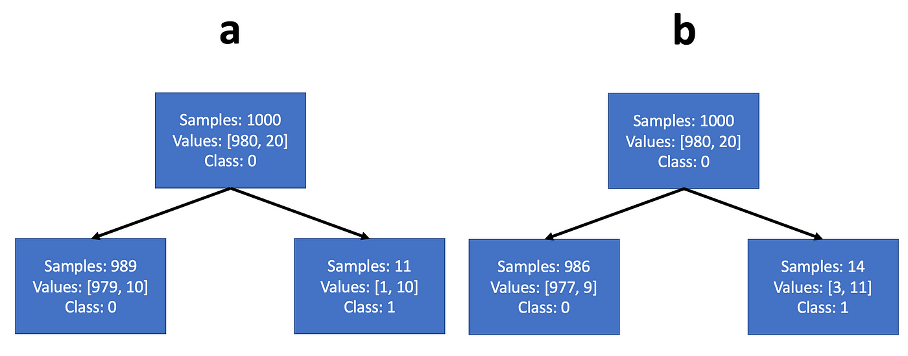

- **Сплит A:** слева 989 объектов $[979, 10]$, справа 11 объектов $[1, 10]$.
- **Сплит B:** слева 986 объектов $[977, 9]$, справа 14 объектов $[3, 11]$.

Что лучше? Просто считаем выигрыш. Gini корня $0.0392$,

$$
\text{Gain}_A \approx 0.0176, \qquad \text{Gain}_B \approx 0.0167.
$$

При Gini выбираем A, если остальные ограничения допускают сплит.

### Критерий остановки

Варианты, когда останавливаться:

- **Чистый текущий узел** — все объекты одного класса, дальше делить не нужно. Чистый *дочерний* узел при этом — допустимый результат, а не причина запрещать разделение.
- **Слишком малый выигрыш** — лучший допустимый сплит почти не уменьшает неоднородность.
- **По размеру и глубине** — проще всего, если вы пользователь дерева и не хотите лезть внутрь и разбираться с энтропией.

Проблема глубоких деревьев: начинается картина «листик — дерево, листик — дерево», когда на каждом шаге отщипывается по одному объекту. Это по факту те же ифы и явное переобучение. При этом каждое такое разбиение даёт пусть маленький, но information gain — поэтому от таких ситуаций надо избавляться принудительно. Возникают они как раз когда дерево становится глубоким: наверху деление идёт по действительно информативным правилам, а в глубине начинают выделяться очень узкие характеристики данных.

| Ограничение | Смысл |
|---|---|
| `min_samples_split` | Не разделять узел, если в нём слишком мало объектов (например, лист на 5 объектов не делим на 3 и 2) |
| `min_samples_leaf` | Не создавать слишком маленькие листья (разбиение 1 к 99 сразу не рассматривается — оно выделяет что-то очень специфическое, возможно шум) |
| `max_depth` | Ограничить глубину дерева |
| `max_leaf_nodes` | Ограничить общее число листьев, чтобы дерево не становилось слишком широким |

Число листьев связано с глубиной, поэтому самый частый вариант, чтобы не запариваться, — просто ограничить глубину: дерево не глубже 8, 5, 3 и т. д. Часто делают и так: строят дерево глубоко-глубоко, а потом обрезают — всё, что ниже 5, больше не интересно.

Значения ограничений выбираем по validation или CV, а не по качеству на train.

### Остановка через статистические тесты

Можно проверять связь признаков с классом внутри текущего узла и останавливаться, если убедительных свидетельств связи нет. Это честный подход: разделение дало статзначимую разницу — используем. Но возникает вопрос, какое из всех статзначимых разделений важнее, и мы откатываемся обратно к information gain. Когда-то это было прописано в теории, на практике сейчас почти не используется. Стандартный CART выбирает сплиты по уменьшению неоднородности.

### Подрезка

1. Построить дерево с достаточно подробными правилами.
2. Заменять поддеревья листьями, получая более простые варианты.
3. Выбирать степень упрощения по validation/CV.

Например, **cost-complexity pruning** сочетает неоднородность листьев на train и их число:

$$
R_\alpha(T) = R(T) + \alpha\,|\text{leaves}(T)|
$$

Чем больше $\alpha$, тем сильнее штрафуем сложность. В scikit-learn это параметр `ccp_alpha`.

## Регрессионные деревья

С классификацией понятно: разбили на категории, в листьях определили класс. А что делать с регрессией?

Идея «на одном ребре плюс, на другом минус» не работает: масштаб должен быть одинаковым у каждого ребра, а данные бывают разные — дома высотой от 0 до 10 метров и жуткие высотки на 200 метров, а между ними ничего.

Идея лучше: у нас везде есть данные. Если в листе 44 объекта, посчитаем среднее значение $y$ и отдадим его. Это самая близкая аппроксимация: эти объекты больше всего похожи на наш, и ничего, кроме их среднего, мы про них сказать не можем.

При квадратичной ошибке оптимальный постоянный прогноз — среднее:

$$
\hat{y}_L = \frac{1}{|L|}\sum_{i \in L} y_i
$$

Сплит выбираем по уменьшению взвешенной внутригрупповой MSE.

### Как дерево переобучается

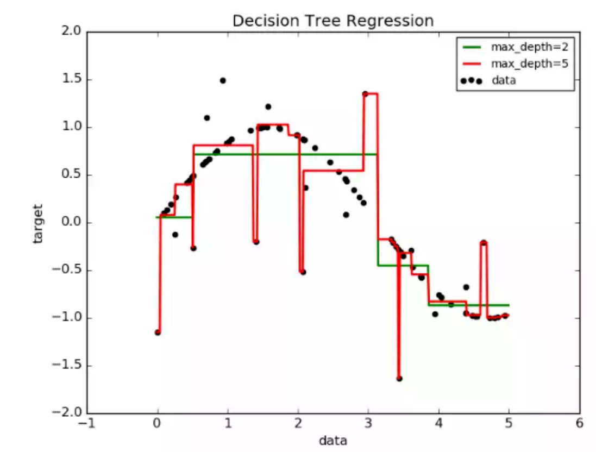

Тренировочные данные — чёрные точки. В них есть нелинейность (что-то похожее на синусоиду) и выбросы. Зелёный график — дерево глубины 2: при $x = 2$ оно вернёт примерно $0.5$, при $x = 3$ — примерно $-1$ и т. д., без выбросов. Красный график — глубина 5: дерево глубокое, умеет отделять очень маленькие кусочки и начинает цеплять выбросы. Раз — выброс, и мы в него упали, два — опять упали. Этими кусочками задача регрессии по факту ломается, и здесь чётко видно, как работает переобучение.

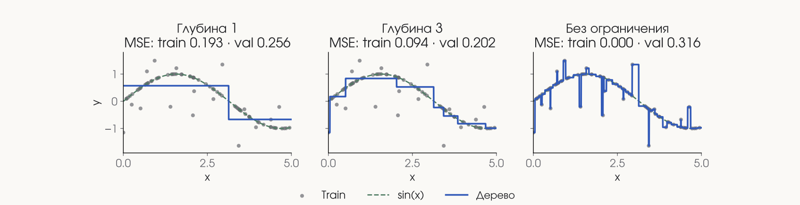

| Глубина | Train MSE | Val MSE | Что происходит |
|---|---|---|---|
| 1 | 0.193 | 0.256 | Одно разбиение — всего два возможных значения |
| 3 | 0.094 | 0.202 | Кусочная функция, которая классно описывает данные; где-то ошибаемся больше, но в среднем хорошо |
| Без ограничения | 0.000 | 0.316 | Подгоняемся под все точки и тупо переобучаемся |

**Переобучение:** модель подстраивается под случайные особенности train, которые не повторяются на новых данных. Чем подробнее разбиение, тем легче выделить отдельную шумную точку в собственный лист.

**Почему маленький лист запоминает шум.**

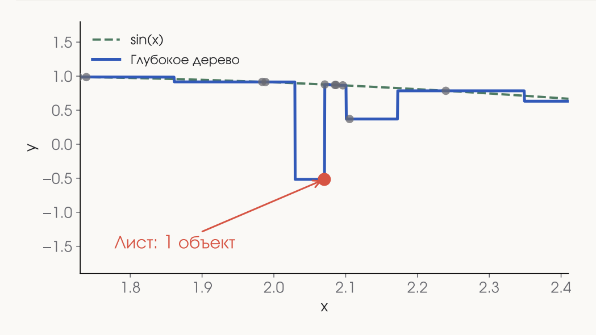

Если в листе один объект, то

$$
\hat{y}_L = y_i = f(x_i) + \varepsilon_i.
$$

Ошибка на этом train-объекте равна нулю. Но на новом объекте случайная ошибка будет другой, и узкая ступенька её не предсказывает.

### Ошибка на train и validation

Эксперимент: 80 train-объектов и 2000 независимых validation-объектов, меняем максимальную глубину от 1 до 10.

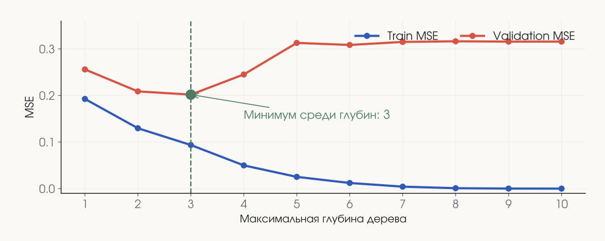

- **Train:** чем больше глубина, тем лучше подгоняются обучающие точки, MSE падает до нуля.
- **Validation:** после некоторой глубины ошибка растёт. Минимум — на глубине 3.

Единственный параметр, который мы меняли, — глубина. Именно его нужно оптимизировать, чтобы дерево не переобучилось.

### Как уменьшить переобучение

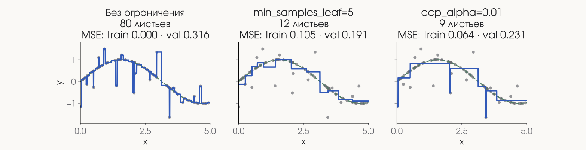

|               | Без ограничения | Минимум 5 в листе | Подрезка $\alpha = 0.01$ |
|---------------|-----------------|-------------------|--------------------------|
| Листьев       | 80              | 12                | 9                        |
| Train MSE     | 0.000           | 0.105             | 0.064                    |
| Validation MSE| 0.316           | 0.191             | 0.231                    |

Ограничение роста не даёт создать маленькие листья; подрезка удаляет ветви уже построенного дерева.

### Как выбрать сложность

|               | Train           | Validation           |
|---------------|-----------------|----------------------|
| Недообучение  | Высокая ошибка  | Высокая ошибка       |
| Переобучение  | Низкая ошибка   | Заметно хуже train   |

1. Обучаем варианты глубины, размера листа и степени подрезки на train.
2. Выбираем параметры по validation или кросс-валидации.
3. Один раз оцениваем выбранную модель на отложенном test.

Нулевая ошибка на train не означает хорошую модель.

И по секрету: деревья решений имеют свойство просто нещадно переобучаться, и избавить их от этого практически невозможно. Поэтому в продуктовых задачах отдельные деревья решений использовать нельзя. На следующей паре будем учить их вести себя нормально: брать много деревьев и делать с ними что-то интересное.

## Важность признаков

Нарисовать дерево из scikit-learn можно через Matplotlib (кажется, `plot_tree`). Руками там довольно много кода, так что проще попросить Codex — не лезьте сами в документацию.

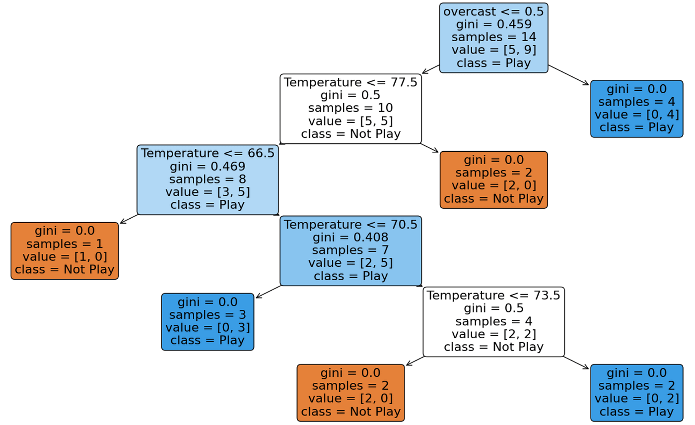

В корне дерева — `overcast`, ниже несколько раз — `Temperature`. Какие признаки важны? Целевая переменная, очевидно, была бы самой важной, но по ней мы не делим — мы её предсказываем. `samples` — это просто число объектов. А вот температура кажется полезной: она встречается в четырёх узлах и каждый раз даёт прирост информации. Достаточно ли смотреть на первый сплит или на число узлов? Нужно оценить численно.

### MDI: Mean Decrease in Impurity

Насколько признак в среднем уменьшил неоднородность обучающей выборки. Для каждого узла $t$ считаем взвешенный прирост информации (родитель минус два ребёнка):

$$
\Delta_t = \frac{n_t}{N}\left(I_t - \frac{n_L}{n_t} I_L - \frac{n_R}{n_t} I_R\right).
$$

Складываем приросты по всем узлам, где использовался признак $j$, и нормируем:

$$
A_j = \sum_{t:\ \text{feature}(t) = j} \Delta_t, \qquad \text{MDI}_j = \frac{A_j}{\sum_k A_k}.
$$

- $N$ — размер train, $n_t$ — число объектов в текущем узле.
- При ненулевом суммарном вкладе сумма MDI равна 1.

**Пример на погодном дереве.** Для `overcast` есть только корневое разделение:

$$
A_{\text{overcast}} = \frac{45}{98} - \frac{10}{14}\cdot\frac{1}{2} - \frac{4}{14}\cdot 0 = \frac{5}{49} \approx 0.102.
$$

Все листья чистые, поэтому суммарное уменьшение Gini равно Gini корня:

$$
A_{\text{Temperature}} = \frac{45}{98} - \frac{5}{49} = \frac{5}{14} \approx 0.357.
$$

| Признак     | Суммарный вклад | MDI после нормировки |
|-------------|-----------------|----------------------|
| overcast    | 0.102           | 0.222                |
| Temperature | 0.357           | 0.778                |

Температура даёт больший прирост информации. Первый сплит не обязан давать наибольшую суммарную важность.

### Проблема MDI: считается для конкретного дерева

И это плохо. Пусть в данных есть температура и в Цельсиях, и в Кельвинах: $T_K = T_C + 273.15$. Класс — «тепло», если $T_C > 20$.

| $T_C$ | 10     | 15     | 25     | 30     |
|-------|--------|--------|--------|--------|
| $T_K$ | 283.15 | 288.15 | 298.15 | 303.15 |
| Класс | No     | No     | Yes    | Yes    |

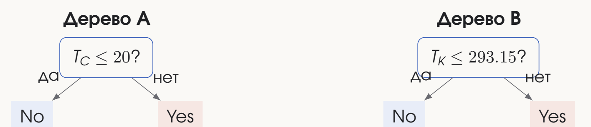

Дерево A делит по $T_C \le 20$, дерево B — по $T_K \le 293.15$. Оба дерева одинаково хороши: на новых объектах $T_C = 12, 18, 22, 28$ оба дают правильные ответы, accuracy 4/4. Но в каждом дереве один сплит, $A_j = 0.5$ для выбранного признака и $0$ для другого. В дереве A MDI Цельсия равна 1, Кельвинов — 0; в дереве B наоборот.

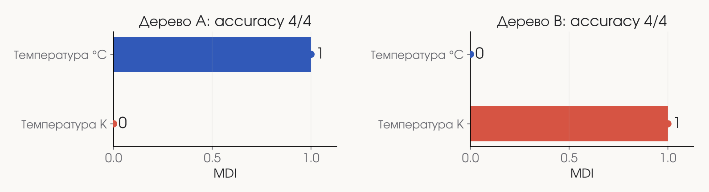

Хотя на самом деле важность у них одинаковая: просто они взаимозаменяемы, и раз использовали один, второй уже не нужен.

Мысль из зала «надо посмотреть зависимость признаков друг с другом» очень правильная, и делать это в целом очень надо. Но у MDI по-другому поступить нельзя: она просто оценивает конкретное дерево.

**MDI зависит от выбранных правил.** Взаимозаменяемая информация может целиком приписаться одному из столбцов.

Ещё ограничения:

| Признак | Возможности поиска сплита |
|---|---|
| Признак 0/1 | Одно нетривиальное разбиение |
| Непрерывный шум | Много порогов — больше возможностей случайно уменьшить train-неоднородность |

Глубокое дерево может использовать шум, чтобы запомнить train. Большая MDI означает вклад в построенное дерево; полезность на новых данных нужно проверять отдельно.

### Permutation importance

Если хочется оценить важность признака не для конкретного дерева, а в целом, есть **важность перестановок**. Идея: возьмём, например, ветер и тупо перемешаем его значения. Насколько хуже станет предсказание? Если сильно хуже — признак был очень важен. Если ничего не поменялось — признак бесполезен, его можно вообще не использовать.

1. Проверяем качество обученной модели на validation: $s$.
2. Перемешиваем один столбец $X_j$ между строками; $y$ и остальные столбцы сохраняем.
3. Считаем качество $s_j^{\text{perm}}$ без переобучения модели.
4. Повторяем с разными перестановками и усредняем разность.

$$
PI_j = s - \text{mean}\left(s_j^{\text{perm}}\right)
$$

Здесь $s$ — score, где больше лучше. Для MSE: $PI_j = \text{MSE}_{\text{perm}} - \text{MSE}_{\text{base}}$.

Делаем это для каждого признака независимо и выстраиваем их в рядочек: признак, от перемешивания которого качество портится сильнее всего, — самый важный.

**Пример: перестановка ветра.** Берём четыре Rainy-строки из первой таблицы. У готового дерева: Strong → No, Weak → Yes.

| День | Ветер  | Играем? | После перестановки | Новый прогноз |
|------|--------|---------|--------------------|---------------|
| 5    | Strong | No      | Weak               | Yes ✗         |
| 6    | Strong | No      | Strong             | No ✓          |
| 7    | Weak   | Yes     | Strong             | No ✗          |
| 10   | Strong | No      | Strong             | No ✓          |

|                    | До     | После  |
|--------------------|--------|--------|
| Правильные ответы  | 4 из 4 | 2 из 4 |
| Accuracy           | 1.0    | 0.5    |

$s - s^{\text{perm}} = 1.0 - 0.5 = 0.5$. Условия дерева остались прежними, изменился только ветер в строках. Вывод: прогноз этого дерева зависит от ветра. Но 0.5 относится к одной перестановке четырёх строк, а не к общему рейтингу признаков.

**Другие перестановки того же ветра.** Три значения Strong и одно Weak; Weak может попасть в любую из четырёх строк.

| Куда попал Weak | Accuracy после | Падение |
|-----------------|----------------|---------|
| День 5          | 0.5            | 0.5     |
| День 6          | 0.5            | 0.5     |
| День 7          | 1.0            | 0.0     |
| День 10         | 0.5            | 0.5     |

$$
\text{Среднее падение} = \frac{0.5 + 0.5 + 0 + 0.5}{4} = 0.375.
$$

Одна перестановка может дать ноль даже для используемого признака. Здесь перебрали все варианты, обычно же усредняем несколько случайных перестановок на validation.

**Переставим влажность на ветке Rainy.** На этой ветке дерево проверяет только ветер, его оставляем прежним.

| День | Влажность до | Влажность после | Прогноз до и после |
|------|--------------|-----------------|--------------------|
| 5    | High         | Normal          | No                 |
| 6    | Normal       | High            | No                 |
| 7    | High         | High            | Yes                |
| 10   | High         | High            | No                 |

$PI_{\text{Humidity}} = 1.0 - 1.0 = 0$ — для этих строк прогноз не зависит от влажности. Но на ветке Sunny влажность используется! Ноль на подмножестве не означает ноль на всей выборке.

**PI в двух равноценных деревьях.** Вернёмся к $T_C$ и $T_K$. Меняем порядок одного столбца на обратный ($T_C = 12, 18, 22, 28 \to 28, 22, 18, 12$), второй столбец и классы оставляем.

| Переставленный столбец | Падение accuracy у A | Падение accuracy у B |
|---|---|---|
| $T_C$ | 1.0 | 0.0 |
| $T_K$ | 0.0 | 1.0 |

PI тоже оценивает конкретную модель: A использует $T_C$, B использует $T_K$. К тому же перестановка нарушает связь $T_K = T_C + 273.15$ — получаются сочетания, которых не бывает в исходных данных.

### Как читать permutation importance

| Важность | Интерпретация |
|---|---|
| Большая положительная | Качество этой модели на этих данных ухудшилось без исходной связи признака |
| Около нуля | Перестановка мало повлияла; проверьте разброс, качество модели и корреляции |
| Отрицательная | После перестановки стало лучше: возможны шум оценки или вредная зависимость модели |

Повторения оценивают разброс перестановок; другие train-split и модели могут дать другой рейтинг.

### Если признаки коррелируют

Пусть $x_A$ и $x_B$ несут почти одну и ту же информацию.

| Что делаем | Что сохраняется |
|---|---|
| Перестановка $x_A$ | Исходная информация в $x_B$ |
| Перестановка $x_B$ | Исходная информация в $x_A$ |
| Одна перестановка для пары | Разрушаем связь с target, сохраняя связь внутри пары |

Низкая индивидуальная важность не доказывает, что информация пары бесполезна. Эффект зависит от модели: одно дерево может выбрать одну копию и игнорировать другую.

### MDI vs permutation importance

|             | MDI                          | Permutation                              |
|-------------|------------------------------|------------------------------------------|
| Данные      | Статистики train-узлов       | Выбранный набор, обычно validation       |
| Оценка      | Уменьшение impurity          | Изменение выбранного score               |
| Шкала       | Доли, обычно сумма 1         | Единицы метрики; сумма не обязана быть 1 |
| Модель      | Дерево / ансамбль деревьев   | Любая готовая модель                     |
| Ограничения | Много порогов, переобучение  | Корреляции, разброс, качество модели     |

Способ с перестановками работает не только для деревьев, а вообще для чего угодно. Ни одна оценка сама по себе не доказывает причинный эффект.

### Можно ли удалить неважный признак?

Рейтинг — гипотеза для нового эксперимента: убрать признаки, переобучить и проверить качество.

| Часть данных | Что делаем |
|---|---|
| Train-часть каждого CV split | Оцениваем важность, выбираем признаки и обучаем модель; при необходимости используем внутренний split |
| Validation-часть CV split | Проверяем всю процедуру отбора и обучения |
| Финальный test | Используем после выбора процедуры |

Нельзя выбрать top-k по всему датасету, а затем считать CV независимой проверкой.

## Итоги

- Путь от корня до листа задаёт набор правил и прогноз.
- Обучение жадно выбирает допустимый сплит по взвешенному уменьшению Gini, энтропии или MSE.
- Рост ограничивают чистота узла, выигрыш, размер и глубина; дерево можно подрезать.
- При MSE прогноз листа — среднее. Train-ошибка не оценивает обобщение; сложность выбираем по validation/CV.
- MDI суммирует вклад в train-разбиения. PI измеряет изменение качества фиксированной модели при перестановке.
- Проверяем шум, корреляции и качество после отбора. Важность не доказывает причинность.

На следующей паре — **случайный лес и бустинг**: как превратить одно страшное дерево в много хороших, чтобы они работали.
